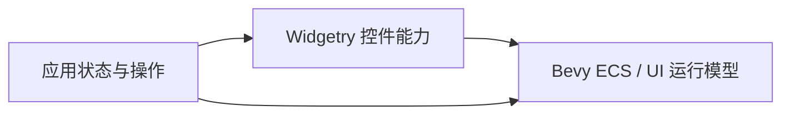
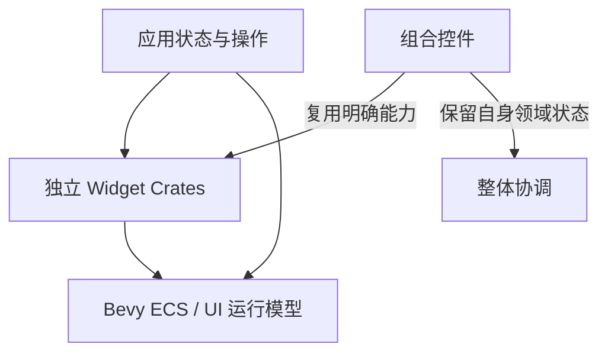
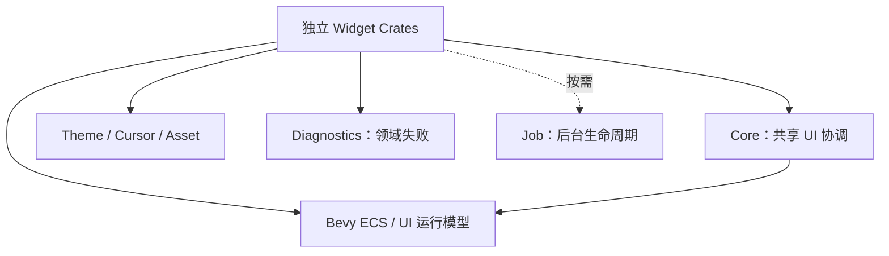
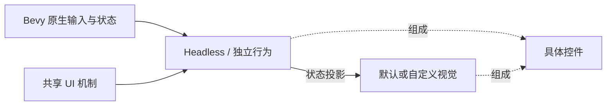
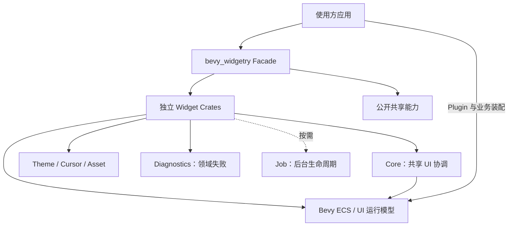

# Widgetry 整体设计

Widgetry 在 Bevy 原生 UI 体系之上提供可组合的控件与共享能力。控件保留自身的领域状态和行为，公共机制协调跨控件的一致性，顶层入口聚合对外 API。

这套组织方式不建立第二个 UI 运行时：应用仍然通过 Bevy ECS、BSN、Plugin、Query、Commands 和 Observer 构造界面并处理业务。

## 让控件直接参与 Bevy 的运行模型

控件首先是 Bevy 世界中的实体和组件。BSN 描述它的初始结构，Plugin 安装相应系统，运行中的状态与输入继续使用原生 ECS 机制。

能够复用的原生状态直接沿用；需要增加的领域状态由 Widgetry 的对应能力保存。界面不需要在“Widgetry 对象”和“Bevy 实体”之间维护一套平行身份。

这种直接接入使控件可以与普通 Bevy UI 和系统协同工作，而不是要求应用先迁入一个封闭的界面框架。

## 用独立模块承载明确的领域

控件增加后，若把所有状态和行为集中到一个大模块，局部变化就会不断牵连其他控件。Widgetry 以独立 crate 承载具体能力，使状态、操作和视觉实现有清楚的归属。

独立不意味着禁止组合。复杂控件在语义上确实需要子能力时，建立单向的实现依赖；只为调用一段方便代码而互相牵连，并不是这套组织的目的。

领域不完全等同于屏幕上的一个矩形。CanvasDocument、波形 Source 适配和任务控制都有自己的数据或生命周期，不能仅因为最终呈现在 UI 上就被视为视觉子部件。

## 把共同问题交给共享机制

多个控件都会遇到禁用继承、输入目标、主题配色和错误传播。如果每个模块分别解释这些语义，它们在组合时就难以保持一致。

Core 承载共享 UI 协调，Theme、Cursor、Asset 分别提供颜色、光标与内建资源能力；Diagnostics 保留失败身份与传播语境，Job 管理后台执行生命周期。各模块按需要使用这些能力，而不是每个控件都依赖同一套固定清单。

共享层统一的是协作关系，不集中拥有全部控件状态。Button 提出 Loading 禁用理由，Core 计算有效禁用；控件提交错误，Diagnostics 保留来源，宿主决定最终处理；后台工作由 Job 纳管，业务结果是否过期仍由发起模块判断。

这些稳定关系使新的控件能够接入现有体系，而不必复制另一份公共机制。

## 将可复用行为与默认视觉分开

模块内部同样采用能力组合。对于适合独立使用的交互或状态，Headless 提供行为基础，默认 Style 再组织具体的部件、布局和反馈。

行为状态由对应能力保存，文字、背景或 Spinner 不是第二份状态权威。自定义外观因此可以在构造时选择不同的视觉组合，而无需重写同一套行为。

并非所有模块都机械地拆成相同三层。Slider 的数值能力、TextField 的根与 Editor、Canvas 的 Document 与 View 有不同结构；共同点是先明确状态和职责，再让视觉消费它们。

复杂控件继续复用完整子控件。被组合者处理自己的局部行为，外层只增加整体业务与协调，不通过递归改写所有后代来冒充组合。

## 通过明确协议连接异步与呈现

业务更新、输入提交、部件物化和视觉同步并不总在同一时刻完成。共享调度顺序和明确的已提交状态，让消费者知道自己读取的是什么。

数据视图使用稳定业务身份，而不是把复用 Row 或 Cell 当成数据本身。异步结果携带请求与会话身份，不因为最后返回就自动拥有覆盖当前画面的资格。视觉结构失败也不当然回滚已经成功提交的领域状态。

这不是一套全局事务系统。每个能力定义自身提交边界，跨模块通过已有的状态、事件、结果与诊断协议协作。更具体的过程分别放在 [机制设计](mechanisms/README.md) 中。

## 由 Facade 聚合，再交给应用装配

实现拆分之后，顶层 `bevy_widgetry` Facade 提供统一公开入口，通过 Feature 选择相应能力。它不承载控件业务，也不让下层模块反向依赖自己。

Feature 决定编译和公开范围，不替代运行时装配，也不消除组合控件真实的下层依赖。应用安装所需 Plugin、注册 Renderer、提供 Model 和业务控制器，并决定错误终结、任务关闭及数据持久化策略。

库因此提供的是可以组合的能力和稳定协作关系，而不是替所有应用预设一种完整的运行方式。
