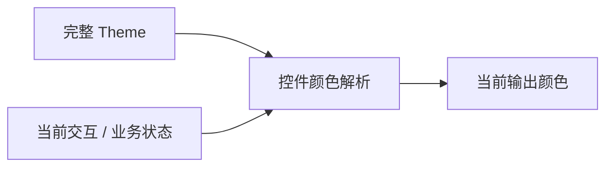
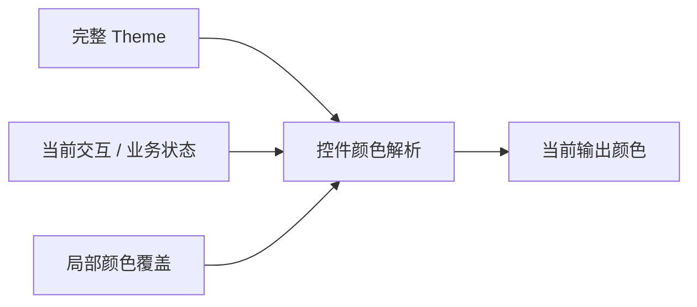
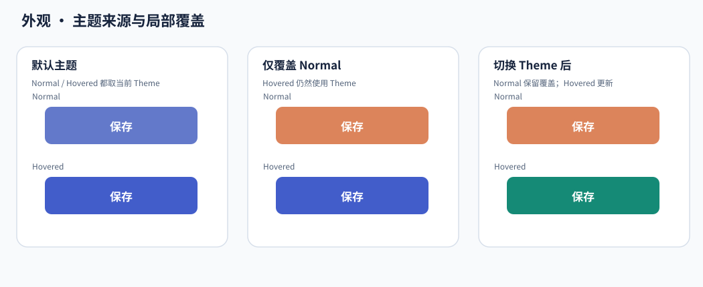
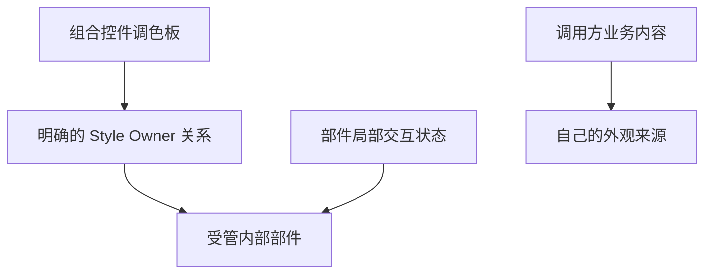

# 主题、局部覆盖与样式归属

同一个按钮可以作为独立控件，也可以成为对话框的内部动作。外观机制需要让它们共享主题与交互语义，同时保证组合控件能够统一自己的部件，而不侵入调用方提供的内容。

## 主题给出默认颜色，控件选择当前状态

Theme 保存完整配色，控件结合 Hover、Pressed、Disabled、Selection 等实际状态选择相应颜色。主题并不直接遍历实体修改外观。

这样，主题切换与控件状态变化走同一解析关系。Button 不会因为切换主题而丢失 Loading，Table 也不需要重新创建业务单元格。

## 局部覆盖只替换明确填写的字段

颜色覆盖保存的是局部选择，不是整份主题副本。未覆盖字段继续读取当前 Theme，清除覆盖后重新回到主题来源。

下面观察主题变化时，明确覆盖的字段与没有覆盖的字段如何分别变化。

覆盖某一个状态的背景，不表示同时冻结其他状态的文字、边框和悬停颜色。因此局部定制仍可以与全局主题切换共同工作。

## 组合控件决定自己部件的最终配色来源

MessageBox 的结果按钮需要使用对话框提供的配色，而正文里应用放入的普通 Button 可能仍需沿用自身设置。仅凭“都是后代”无法区分这两种情况。

组合层因此建立明确的 Style Owner 关系。被管理部件消费最终拥有者提供的调色板，并继续根据自己的局部交互选择输出；不再用自身 Theme 覆盖组合层决定。

Owner 关系在构造与真实部件变化时维护。部件脱离后结束旧归属，新建或重挂后补齐当前归属；稳定帧不需要递归整棵业务子树寻找所有者。

## 前景传播连接内容，而不接管所有文本

解析后的前景色沿参与机制的层级传递给 Widgetry 管理的 Text 和 Icon。显式颜色及有效 Disabled 规则参与相应解析，普通原生文本仍保留自己的定义。

因此，按钮可以让自己的标签与图标随状态变化，但不会把同一页面所有文字都强行染色。内容构造和颜色更新也彼此独立：颜色变化不是重建 Renderer 内容的理由。

## 更新围绕真实失效范围进行

主题或 Override 改变会使相关调色板失效；局部 Hover 通常只影响当前部件；虚拟化 Row 改绑时则需要按新业务身份刷新。输入、所有权和内容身份是不同的失效来源。

共享阶段先完成部件与归属，再解析颜色和传播前景。持续样式故障由对应拥有者保存，健康兄弟部件成功不等于失败部件已经恢复。

这使默认样式能够保持跨控件一致性，同时仍然保留模块与调用方各自的视觉边界。
