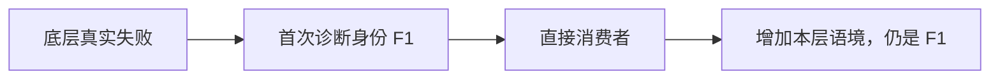
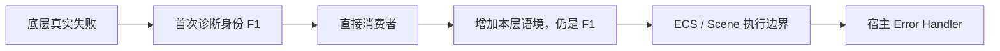
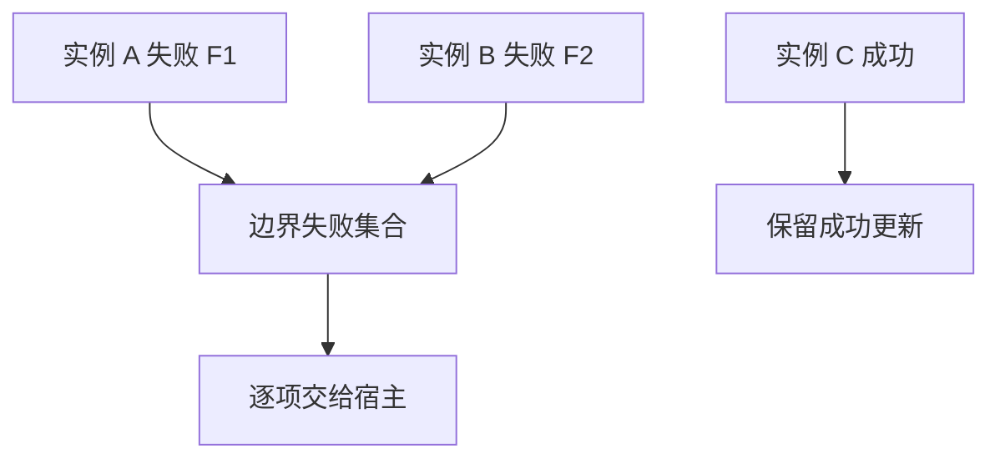

# 跨模块诊断传播

一个底层失败可能经过输入控件、组合控件、后台任务和 ECS 边界。传播机制要保留它的真实起点，同时让每一层增加自己知道的语境；不能为了统一返回值把原因压成字符串，也不能让每层各自重新报告同一个源头。

## 让来源身份跟随失败，而不是跟随包装层

首次纳入真实错误时，Diagnostics 建立 origin，保存身份、业务位置和原始线程回溯。上层接到的是已有失败，添加上下文或映射领域类别时继续保留同一 origin。

例如文件读取失败经过磁盘 Source 和 WaveformRuntime，Source 知道路径与请求，Runtime 知道会话和视图。它们补充的是同一失败的两层信息，不是两次新的 I/O 失败。

不同请求恰好返回同一文案，仍可能是不同错误身份。身份不依赖 Display 字符串比较。

## 在边界转换，不在每一层丢失类型

普通模块 API 返回能够匹配领域类别的失败。只有进入 System、Observer、Commands 或 Scene 等执行边界时，才转成 Bevy 错误。

已经受管的下层错误保留其 origin 和 source；原生 Bevy 错误保留原对象、严重级别和 payload。适配不以“全部格式化成字符串”换取表面统一。

跨线程同样保持这一原则。后台失败到主线程时，不能用主线程重新捕获的回溯冒充后台发生位置。

## 批处理必须保留每个独立失败

UI 一帧内可能同时更新多个控件。一个实例失败不应让后面的健康实例失去更新，也不应让后面的失败被悄悄丢掉。

集合只负责共同交付，不把 F1、F2 合成一个原因身份。组合控件还会补充业务 Owner、部件和操作阶段，让宿主知道失败影响哪一部分。

## 持续故障不是每帧的新失败

缺失一个 Renderer 可能连续影响多帧。如果每帧都建立新 origin，日志会掩盖真正的起点；如果直接把重复返回当成成功，宿主又会失去真实失败状态。

拥有者因此以业务键保存活动诊断：同一对象、阶段和原因继续返回同一失败，真正重新验证成功才报告恢复。更换请求、部件身份或失败原因后，才建立新的来源。

| 场景变化 | 来源身份 | 含义 |
| --- | --- | --- |
| 同一个部件仍缺 Renderer | 保留 F1 | 故障持续 |
| 暂时没有运行到该部件 | 保留 F1 | 不能据此宣布恢复 |
| Renderer 补齐并成功使用 | 结束 F1 的活动状态 | 真实恢复 |
| 随后另一项内容构造失败 | 新建 F2 | 独立失败 |

对象正常销毁只是释放状态，不伪造恢复。独立 API 调用也不因为它们文案相同，就复用一个永久故障身份。

## 处理、放弃与最终报告各有拥有者

某层实际采用占位图、终止请求或放弃过期结果后，可以记录已采取的处理。只观察、转发、捕获日志或删除对象，不构成业务处理。

异步任务尤其需要明确结果终结者。控件消失后仍可能收到真实失败，收尾拥有者继续等待任务结束，再明确放弃不再需要的结果；不能让取消成为诊断无人接收的理由。

宿主最终报告未处理失败，并按 origin 避免重复终结。日志接收器、弹窗、退出策略属于宿主，不由共享诊断设施替所有应用决定。
