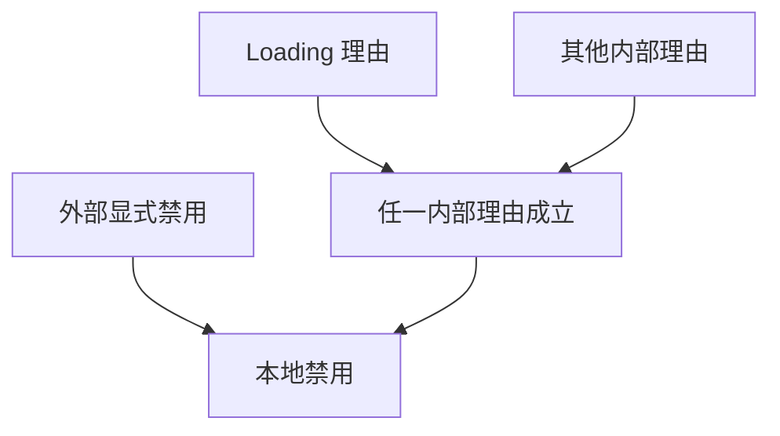
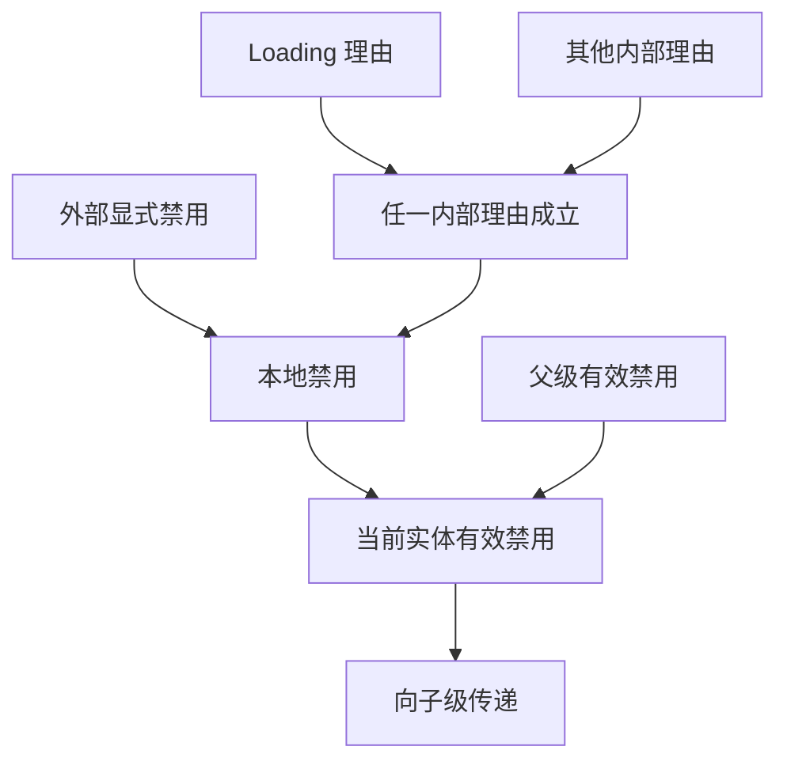
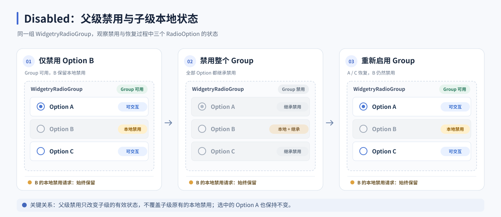
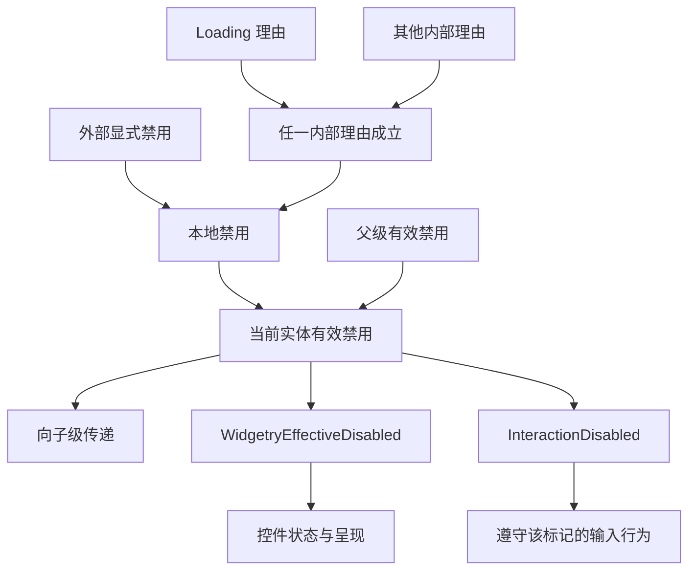

# Disabled 核心设计

Disabled 要解决的是多个来源同时要求禁用时，怎样让它们互不干扰，并使整个 UI 层级得到一致结果。Core 保存各来源的请求，计算有效禁用，再把它交给原生输入和控件呈现。

## 一个禁用结果可以有多个原因

按钮正在 Loading 时，业务也可能显式禁用它。若双方只争写一个布尔值，Loading 结束就可能误把业务仍不允许操作的按钮重新启用。

Core 因此分开保存显式请求和内部理由。内部理由按类型独立登记，任一理由或显式请求成立，本地禁用就成立。

下面只观察同一个按钮，不改变它的父级：

| 发生的操作 | Loading 理由 | 业务显式请求 | 本地禁用 |
| --- | --- | --- | --- |
| 开始 Loading | 有 | 无 | 是 |
| 业务又禁用按钮 | 有 | 有 | 是 |
| Loading 结束 | 无 | 有 | 是 |
| 业务解除自己的请求 | 无 | 无 | 否 |

撤销一个理由只影响该理由。理由的发起者负责开始与结束，Core 不接管其任务生命周期；同类型理由在同一实体上也不是调用次数计数。

## 父级限制参与结果，但不覆盖子级请求

本地没有禁用请求，并不意味着控件一定可交互。RadioGroup 被禁用后，其中的 Option 同样需要停止正常用户交互。

`有效禁用 = 父级有效禁用 OR 本地显式禁用 OR 任一内部理由`

下面保持 Option A 的选中状态和 Option B 的本地禁用请求不变，只切换 Group 的禁用。观察 Group 恢复后 B 是否被错误启用。

Group 正常时只有 B 不可交互；禁用 Group 后三项都不可交互；恢复 Group 后 A、C 可用，B 仍然禁用。选中与可交互是不同状态，因此 A 不需要因为整个组被禁用而失去选择。

关键不是简单地把标记复制给所有孩子，而是保留每个子级自己的请求。子级在继承期间仍可以改变本地请求，父级恢复后按当前请求重新得到结果。

传播沿实体父子层级到达受管理 UI，不通过原生窗口 Owner 关系跨窗口继承。

## 用同一个结果服务不同消费者

Core 把计算结果写入只读的 `WidgetryEffectiveDisabled`，并投影到 Bevy `InteractionDisabled`。控件和原生输入由此无需分别遍历父级或推测 Loading 状态。

`InteractionDisabled` 同时承担外部请求入口与有效结果输出。Core 区分自己的投影写入和外部真实修改，否则父级禁用产生的输出就会被误记成子级永久的本地请求。

具有 `Node` 或 `ComputedNode` 的 UI 实体参与状态投影，不必等待完整布局。有效结果本身不决定禁用颜色，也不自动撤销任意业务任务；消费者在自己的职责内使用它。

## 输入适配不改变业务数据

部分原生能力并不检查 `InteractionDisabled`。ScrollArea 的滚轮处理就是这种情况，只写标记还不足以禁用滚动输入。

共享层在有效禁用期间暂停对应滚轮能力，恢复时重新启用，同时保留滚动位置和布局。

| 同一个 ScrollArea | 用户滚轮 | 程序修改滚动位置 | 原滚动位置 |
| --- | --- | --- | --- |
| 正常 | 可用 | 可用 | 保留 |
| 禁用 | 暂停 | 仍可用 | 不被清零 |
| 恢复 | 重新可用 | 可用 | 沿用当前值 |

这说明禁用约束的是用户交互资格，而不是把所有状态冻结。控件仍可根据业务更新内容或程序化位置。

## 在变化影响的范围内重新计算

显式请求、内部理由、UI 组件和父子关系变化，都会使相关子树的有效结果需要更新。Core 标记受影响范围并重算，不在稳定帧反复遍历整个界面。

输入派发前处理已提交的变化，UI 构造与物化后再协调新结构。Commands 排队尚未执行时，请求还没有生效。

因此，禁用来源属于各发起者，组合与继承属于 Core，输入清理和视觉反馈属于实际消费者。三者共享结果，但不相互替代责任。
