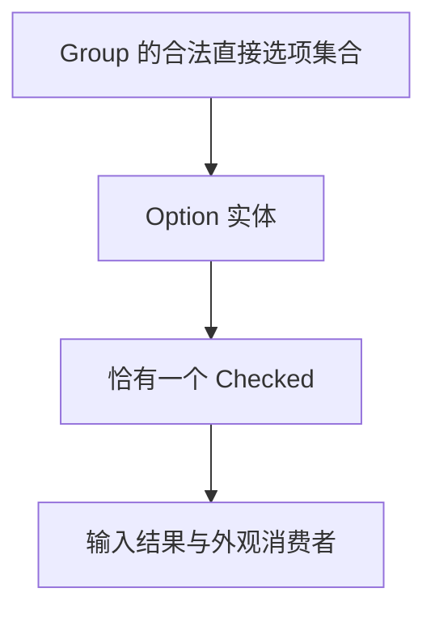
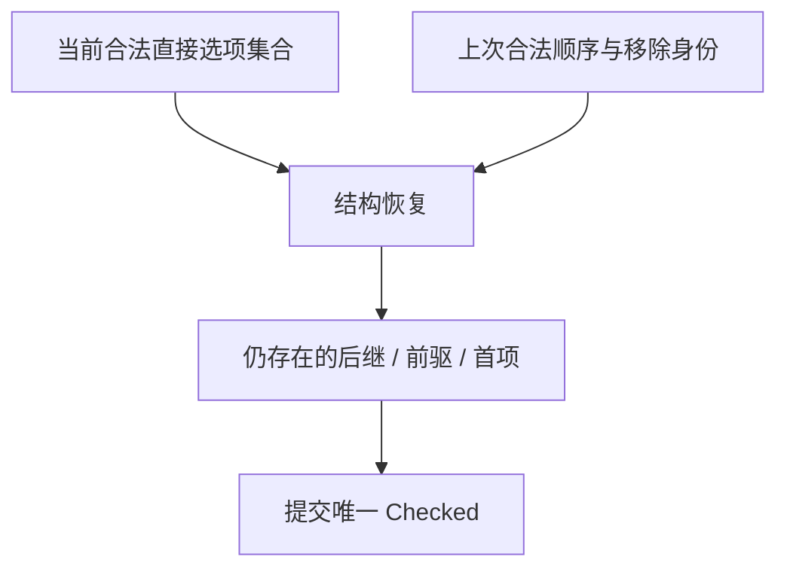
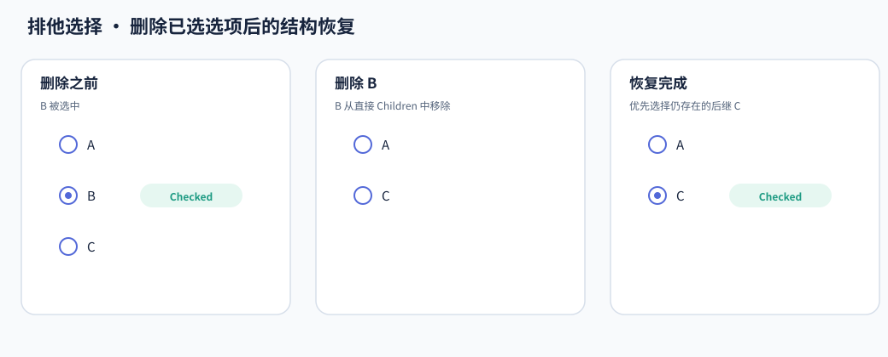

# 排他选择与结构恢复

RadioGroup 和 Segmented 都要求合法组内恰有一个选项被选中。共享机制负责维持这项关系，而选项布局、键盘方向和视觉仍由各控件处理。

## 让 Checked 成为唯一选择状态

选项上的 Bevy `Checked` 表达真正选择。Group 不再保存一个与它并行、需要双向同步的 Selected Entity 字段。

共享提交在合法成员中选择目标，仅改变确实需要改变的 Checked。选择同一项不必制造一次新的状态变化。

首次构造的策略由控件传入：有的采用首项，有的允许一个合法的初始 Checked。共享层提供能力，但不会把不同控件的初始化语义强行抹平。

## 删除选中项后，需要知道它原来在哪里

只看删除后的 Children，无法知道刚删除的选择原本位于哪里。为了确定合理的后继，共享层保存上次合法顺序，以及脱离时的选中身份。

下面观察 A、B、C 中已选 B 被删除后的变化。C 是上次合法顺序中仍存在的后继，因此得到选择。

如果没有后继，再找仍存在的前驱；旧集合已经全部消失时，回到新集合的首项。新增未选项或删除其他选项，则继续保留原已选实体。

顺序历史是恢复依据，不是第二份当前选择权威。正常输入和查询仍读取真实 Checked。

## 结构恢复不是一次用户选择

恢复维护的是组的合法性，不表达用户刚刚点击了哪一项。因此自动恢复不发送普通用户选择事件，也不为了找到“可点项”绕过稳定结构规则。

例如剩余后继处于 Disabled，它仍可能成为结构恢复的 Checked。Disabled 阻止用户操作，不等于这个业务状态不能存在。

| 变化 | 选择结果 |
| --- | --- |
| 添加其他选项 | 保留已有合法选择 |
| 删除未选中项 | 保留已有合法选择 |
| 删除选中项 | 按旧顺序找仍存在的后继，再找前驱 |
| 旧成员全部消失、出现新集合 | 选择新首项 |
| 所有选项都被删除 | 进入空集合结构错误，等待真实结构恢复 |

## 各控件继续拥有成员与输入契约

共享层不判断所有 UI 子节点都一定是选项。RadioGroup、Segmented 负责确认直接成员集合、类型与自己的输入方向，再把合法集合交给共享恢复。

结构变化在正常输入派发前得到协调，避免按键先落到已经失效的选择上。稳定集合不需要每帧重复修复；故障与恢复按实际结构变化处理。

这样，两个控件共享选择不变量，却不需要彼此依赖或继承对方固定的布局、颜色和键盘行为。
