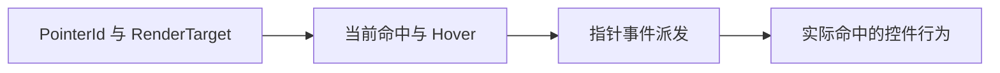
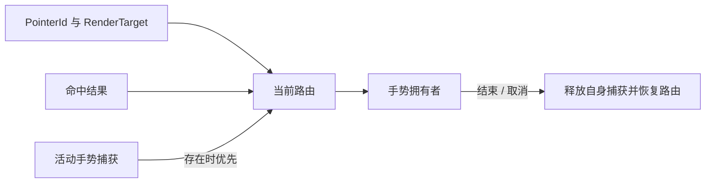
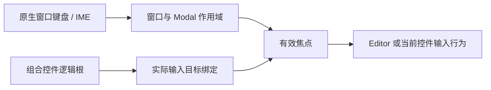

# 输入目标、作用域与手势

同一个界面中，指针命中实体、业务控件根、键盘焦点和原生窗口可能是四个不同对象。共享输入机制连接这些身份，让一个操作由正确的拥有者消费，而不是仅凭“事件出现在附近”就执行行为。

## 输入首先属于具体设备与目标

Pointer 事件携带指针身份、位置和 RenderTarget。Mouse、Touch 与 Custom Pointer 可以经过同样的控件语义，但只有真实鼠标身份对应原生鼠标反馈。

控件不能只记录“按下了”，还需要知道是哪一个 Pointer 在哪个目标上开始操作。这样第二根手指或另一窗口中的释放，不会错误结束第一条手势。

Hover 的共享投影也区分直接命中与后代命中，避免每个控件自行改写同一份 Hover 状态。

## 组合层级不自动扩大操作含义

嵌在 Table 表头中的按钮既处于表格层级内，又具有自己的激活行为。点击它应提交按钮意图，而不是同时触发列拖动或整列选择。

控件因此在相应边界消费指针事件，组合层只解释属于自己区域和语义的输入。根上的其他 Observer 仍可处理同一实体需要的事件，不把停止向祖先传播理解为“整个 App 不再收到任何输入”。

| 命中位置 | 主要含义 | 不应顺带发生 |
| --- | --- | --- |
| 表头排序按钮 | 发送排序请求 | 启动列拖拽 |
| 列宽 Handle | 调整该列宽度 | 重排列顺序 |
| 普通标题主体 | 选择列或开始已启用的重排手势 | 激活内部按钮 |

这种划分是控件协作的一部分，不是给所有容器设置一个通用的吞事件开关。

## 活动手势需要持续的拥有关系

拖动开始后，指针可能离开原命中区域。若继续只依赖 Hover，拖动会中断，或者被途经的另一个控件接走。

捕获拥有者保存开始时的目标与操作含义。Canvas 中已经开始的平移不会因为之后松开 Space 就变成图形移动；同一指针的结束事件也不能越权释放其他拥有者的新捕获。

失焦、取消、目标删除或控件失效后，旧手势结束。结束不必等同于撤销所有已提交业务变化；是否回滚由具体操作语义决定。

## 键盘输入沿实际焦点与窗口作用域派发

键盘不是指针命中的附属物。Window 先确定输入所属的原生窗口和有效作用域，再把事件交给当前焦点目标。

TextField 是最直观的例子：逻辑 Root 保存控件身份，真正接收编辑输入的是 Editor。点击聚焦或窗口初始焦点通过公开的输入目标关系找到 Editor，而不是让每个窗口认识 TextField 的内部层级。

Modal 改变可交互作用域，但不把所有原始输入消息全局吞掉。宿主自己的全局快捷键仍需要理解其业务作用域。

## 可交互资格与输入身份分别检查

知道事件属于哪个控件之后，还要判断它是否可交互。有效 Disabled、可见性和控件自身的操作资格共同决定输入是否成立。

Disabled 是统一结果，具体控件负责在限制生效时结束自己已有的按压或手势。程序化状态操作不自动等同于用户输入，因此不能把禁用当成所有业务 API 的全局锁。

共享输入层由此维护设备、目标、焦点和捕获之间的一致关系；控件仍决定一次输入在自身领域里代表什么。
