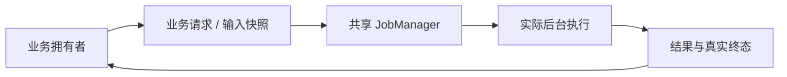
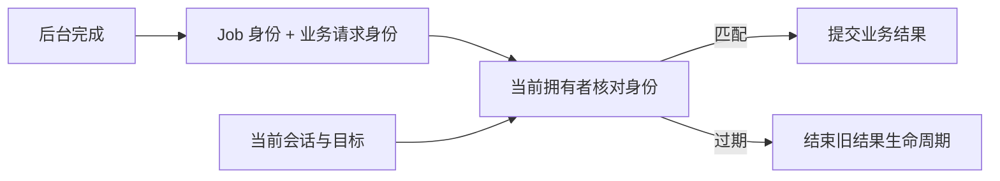
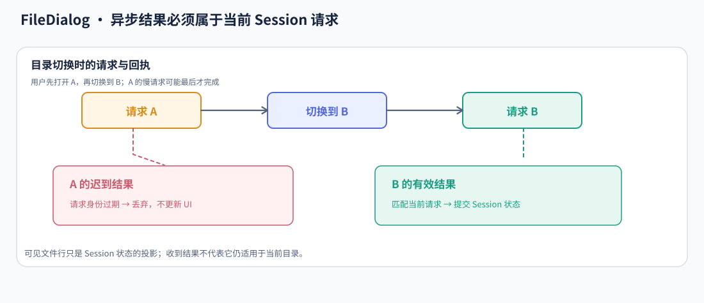

# 后台任务与业务结果提交

共享 JobManager 解决执行生命周期，控件解决业务结果是否仍然有效。两者通过任务身份和业务请求身份协作，使旧工作可以安全结束，而不会覆盖已经变化的界面。

## 把执行交给 Manager，把语义留给消费者

FileDialog 需要目录与文件系统服务，Waveform 需要计算与数据读取，Canvas PNG 导出需要后台编码。它们共享任务管理，但每种任务的输入和结果仍由所属模块定义。

Manager 知道 Job 是否结束，不知道当前目录是否已经切换，也不知道某份降采样是否还属于当前算法。

## JobId 不替代业务请求身份

一个长期线程可以处理许多目录或磁盘读取请求；一个短计算 Job 也可能对应已经被替换的显示目标。因此消费者同时保留业务身份，例如 Session、Generation、Reader 和请求参数。

目录 A 的请求晚于目录 B 返回时，Job 正常完成并不赋予 A 覆盖当前界面的资格。文件浏览场景可以直观看到这一点：

过期结果可以被丢弃，但仍要释放它拥有的资源并处理真实失败。取消请求不替代接收与终结。

## 保留最后一个完整提交，而不是混合新旧片段

Waveform 改变跨度后，目标配置可以先更新，但旧波形与旧时间轴在新结果就绪前仍是一致快照。若先换时间轴再慢慢替换数据，用户会看到属于两个目标的混合画面。

消费者因此区分请求目标与已提交结果。在身份校验通过后，把相关缓存、几何范围和显示语义一起采用；具体需要共同提交哪些部分由业务协议决定。

| 阶段 | 任务状态 | 业务画面 |
| --- | --- | --- |
| 新请求已提交 | Pending / Running | 保留最后完整画面 |
| 结果已产生但未消费 | 可能已完成 | 仍不等于已采用 |
| 身份匹配并提交 | 消费对应结果 | 更新为新快照 |
| 请求已被替换 | 等待真实退出或处理旧结果 | 不提交旧快照 |

## 取消只结束需求，不跳过真实退出

拥有者不再需要结果时请求取消。工作体在可停止处确认并退出，Manager 收割后才发布终态。无法立即中断的 I/O 或 CPU 操作仍然保持真实状态。

长期服务的停止信号、队列清理和线程 Join 属于实际服务生命周期。控件销毁可以把终态接收器交给独立收尾拥有者，避免阻塞 UI，也避免失去迟到失败。

后台任务停止不等于 Manager 记录自动删除；记录移除发生在真正完成后，并由拥有者明确决定。

## 用唤醒连接反应式界面

反应式应用可能在没有输入时停止更新。结果到达、任务结束或需要继续推进的渲染阶段必须具备相应唤醒路径，否则后台已经完成，界面却永远不消费结果。

唤醒服务于真实待处理工作，工作结束后停止请求；不以全局永久刷新替代生命周期协调。应用退出时，关闭协调与各消费者的最后结果处理共同完成，而不是只关闭一个任务池。
