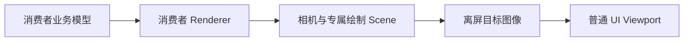
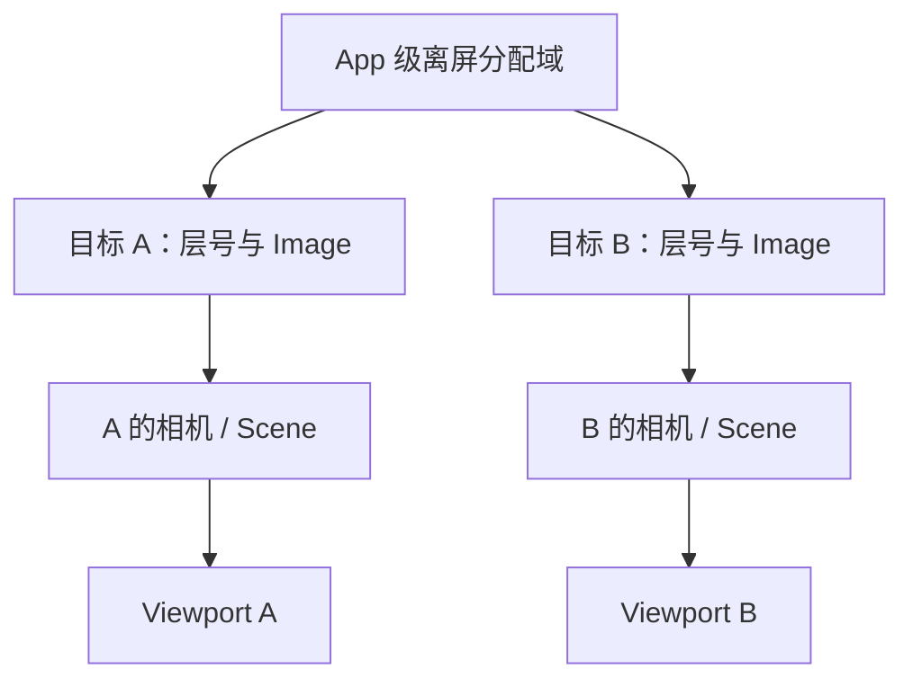
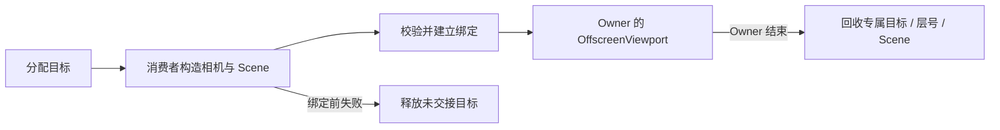

# 共享离屏渲染

Canvas 和 Waveform 都需要把专门的几何绘制放进普通 UI 区域。公共离屏机制管理目标图像、渲染层和 Viewport 关联，消费者则继续拥有自己的模型、相机设置与绘制算法。

## UI 需要的是一个视口，不是另一份业务模型

CanvasDocument 和波形 Source 不属于显示纹理。Renderer 根据业务状态组织专属 Scene，再将其结果交给 UI Viewport。

这样，视图可以隐藏、调整大小或销毁，而不意味着业务数据被复制或删除。

## 为每个目标隔离图像和渲染层

多个离屏控件同时存在时，共用未隔离的层号会让相机拍到其他控件的几何。Core 使用 App 共享的分配域，为目标租用独立层号并创建专属 Image。

Canvas A 和 Waveform B 可以同帧显示，也可以独立销毁。公共池隔离它们的目标，不把所有消费者的 Mesh 或 Material 集中到同一个资源所有者。

消费者负责把自己的相机和几何接到分配的层，并选择 Projection、ClearColor、MSAA 等绘制语义。

## 绑定明确资源何时交给公共生命周期

分配成功后，消费者还需要构造 Scene 并建立 Viewport 绑定。绑定前失败由当前持有者释放尚未接管的目标；绑定成功后，关联保存到拥有者的 OffscreenViewport 中。

绑定校验的是明确的 Owner、Viewport、Camera 和 Scene 关系。失败不能靠猜测回收其他实例已经拥有的对象，也不能因为相机指向某张图就认定所有相关资产都属于当前目标。

## 尺寸来自已完成的 UI 几何

离屏目标使用实际物理视口尺寸，而不是只用初始 Props 或逻辑布局常量。更新位于布局与可见性确定之后，并与原生 Viewport 的图像尺寸更新保持顺序。

隐藏或零尺寸时停用相机，不把它当成资源故障；重新可见后按当前几何继续工作。

| 同一个视图的变化 | 业务模型 | 离屏行为 |
| --- | --- | --- |
| UI 调整尺寸 | 保留 | 更新目标物理尺寸 |
| 临时隐藏 | 保留 | 暂停相机 |
| 重新显示 | 保留 | 按当前布局恢复 |
| 删除视图拥有者 | 可继续存在 | 回收专属目标与绑定 |

## 回收遵循真实拥有关系

公共层回收自己拥有的 Image、层号和专属 Scene，只清除仍指向该相机的 Viewport 关联。消费者的共享 Mesh、Material 或宿主资产由各自的生命周期管理。

因此，删除一个 CanvasView 不应影响另一个共享 Document 的视图；关闭一个波形窗口也不能释放其他窗口的渲染目标。主失败与清理失败都可以保留，清理一部分失败不应使其他可执行回收被跳过。
