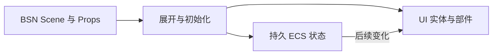
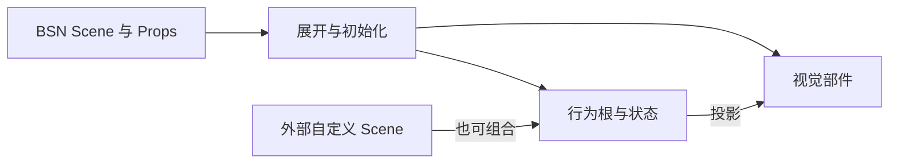
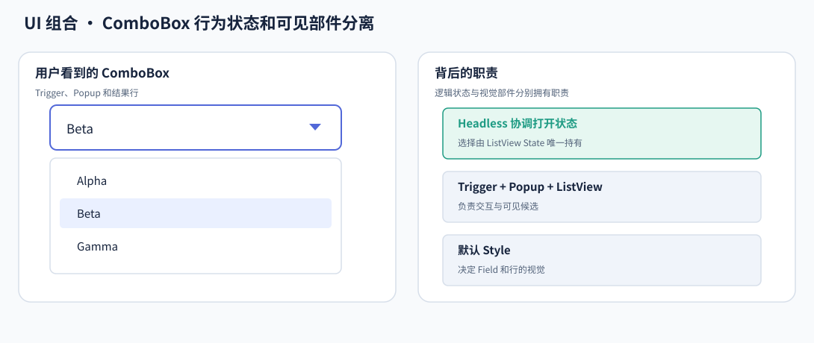
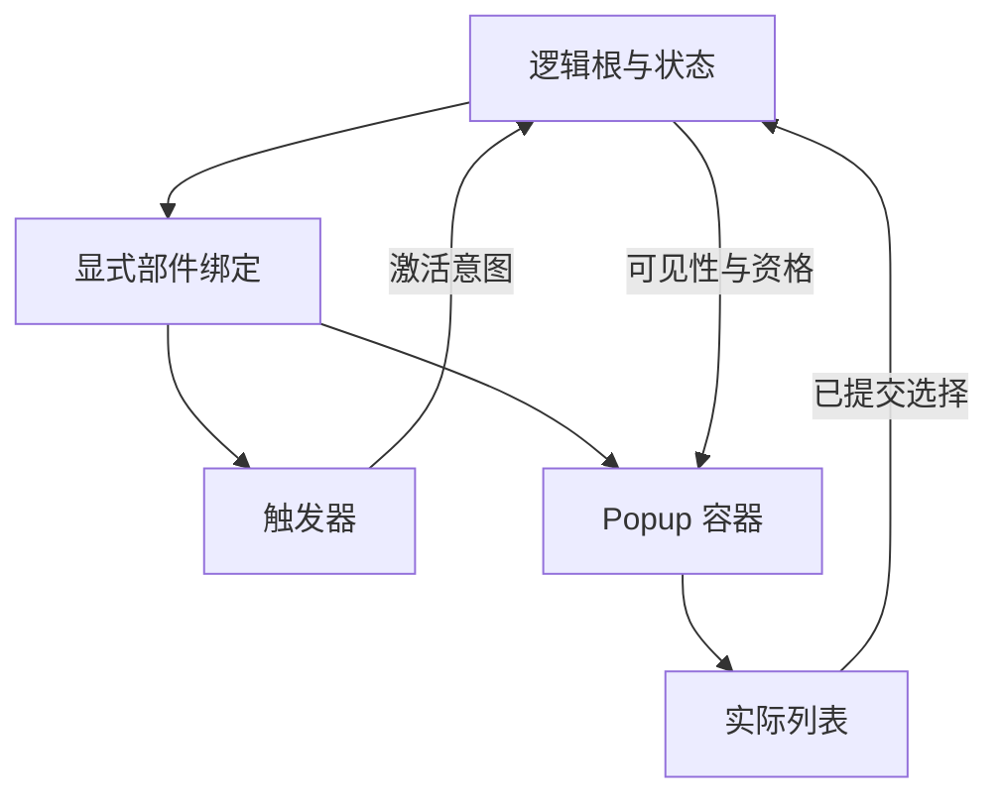

# 控件构造与组合

Widgetry 的组合不是把控件包装进另一套对象树，而是在 Bevy 的实体、组件和 Scene 体系中建立清楚的关系。构造描述决定初始结构，运行状态决定之后的行为，视觉部件则呈现这些状态。

## 从 Scene 建立实体，而不是留下第二份配置状态

BSN 描述组件、子层级和可复用 Scene。Props 在展开时初始化持久组件，随后退出运行过程；控件不同时维护一份 Props 值和一份运行时值。

以 Tabs 为例，初始索引由 Props 提供，创建后的选择由 Tabs 状态保存。切换页面更新这份状态及其页面投影，不是重新执行最初的 Scene 来“刷新配置”。

SceneComponent 用于需要持续身份的抽象，Scene Function 用于结构复用。可复用不等于必须增加一个运行时身份。

## 先组合行为，再决定外观

当一种行为可以独立于外观使用时，Headless 在原根上提供行为与状态，默认控件再组合相应视觉。它不是隐藏在默认 Style 之后的私有实现。

Button 的 Loading 不因为缺少 Spinner 就失效，OpenUrl 不因为链接文字被替换成图标就失去 URL。视觉可以从一开始采用另一套组合，行为仍沿用同一条状态提交路径。

这种分离不等于运行中可以任意拆掉默认 Style 的私有部件。构造时选择不同组合，与把既有托管结构破坏后期待自动重建，是不同操作。

## 逻辑根、输入目标和视觉位置可以不同

复杂控件的输入部件不一定与业务根重合。TextField 的根表达控件身份，真正的编辑状态位于 Editor；ComboBox 的根协调开关，触发器、Popup 和列表分别承担不同任务。

下面观察一个 ComboBox：外框位置可以变化，但触发器仍指向同一个逻辑根，列表仍属于对应 Popup，而不是靠屏幕坐标判断归属。

显式部件绑定让行为可以找到实际输入实体，而无需依赖默认 Style 的固定层数。绑定同时限定拥有范围，不能越过另一个同类控件根，或把任意外部列表误认成自己的子部件。

绑定描述关系，不复制下层状态。ComboBox 复用列表的选择权威，不能再用 Field 文字保存第二份选择。

## 外部内容不等于托管部件

调用方通过 Scene/SceneList 提供标题、正文、图标或页面内容。控件拥有内容容器和明确的内部部件，但不因此拥有容器下每个业务实体的状态。

例如 MessageBox 可以统一管理结果按钮，却不自动接管正文里调用方放入的普通 Button。Tabs 可以隐藏非活动页面的包装层，却不销毁页面模型，也不停止页面的所有业务系统。

组合样式归属因此基于实际部件关系，而不是递归覆盖所有后代。

## 运行阶段把独立能力接起来

Scene 构造、部件物化和状态投影可能发生在不同阶段。共享顺序让新部件先具备身份与归属，再接受 Disabled、颜色和前景输出；不会要求每个控件通过额外整树扫描寻找刚创建的对象。

构造失败的清理也遵循拥有范围：这次新建的临时结构可以回收，原已存在的业务对象和已经提交的领域状态不能被当作失败 Scene 的附属垃圾删除。

这样，同根能力、嵌套控件和外部内容可以共同组成 UI，却仍然保留各自明确的状态与生命周期。
