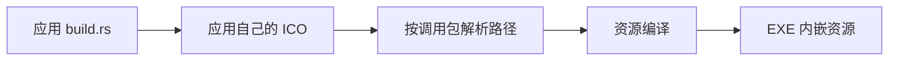

# App Icon Build 核心设计

可执行文件图标应在构建产物中确定，不依赖应用运行后再加载资源。App Icon Build 因此作为构建期工具工作，与 Bevy App、窗口和托盘生命周期分开。

## 由调用应用决定资源

应用提供 ICO 路径，工具以调用包的清单目录解析相对路径。素材归应用所有，工具不选择品牌图像，也不从库的运行时 Asset 中寻找替代。

图标变化通过 Cargo 重建依赖表达。最终运行产物携带资源，不需要再把原始 ICO 作为运行时依赖安装。

## 在进入资源编译前保留可诊断的边界

工具先验证构建环境、路径和文件可访问性，再调用资源编译器。失败分别记录所处阶段，底层环境或 I/O 原因保留为具体错误对象。

这条路径不依赖 ECS Error Handler。构建脚本是失败的直接消费者，决定如何终止构建和展示报告；它不会因为运行期日志系统尚未安装而失去诊断信息。

## 构建身份不等于窗口身份

EXE 图标描述应用文件，窗口图标描述一个运行中的窗口，托盘图标又是独立原生对象。构建工具不创建这些对象，也不拥有它们的关闭策略。这使构建能力可以独立使用，而不会把运行时 UI 依赖拉进 build script。
