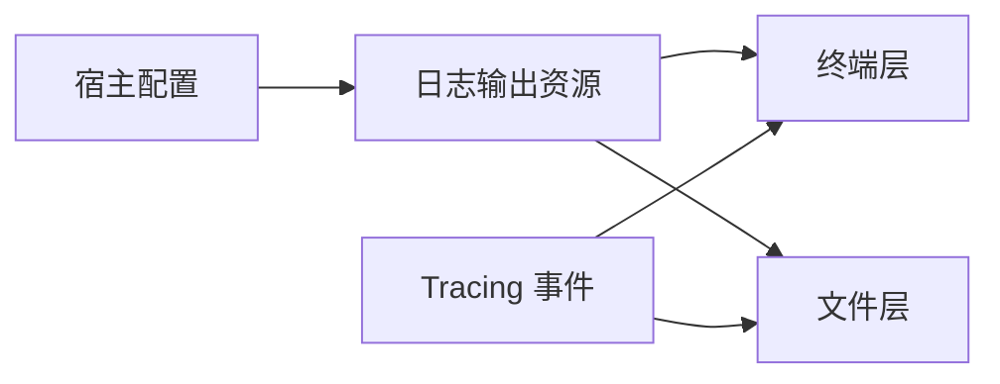
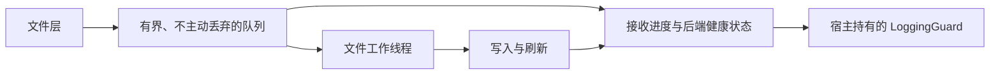

# App Logging 核心设计

日志生产者不应知道文件何时打开、输出过滤如何配置，文件写入也不能悄悄把失败变成“日志已保存”。App Logging 把事件格式、异步文件写入和宿主关闭责任连接起来，但不接管全局错误处理策略。

## 输出配置属于应用

应用先创建日志输出，再把对应资源安装到 App。终端层与文件层读取这一配置，宿主选择将它们装配到哪个 Subscriber。

两层可以采用不同的等级过滤，但不能恢复被外层 Subscriber 提前裁掉的事件。时间、线程和源码位置在事件格式化时确定，而不是由后来的写入线程补造。

文件层的事件格式器从 Metadata 生成模块、文件名和行号，文件名同时识别正反斜杠，避免直接写出编译目录。事件字段和 Span 上下文仍交给 Tracing 字段格式化协议。该处理在入队之前完成，不改变异步 Writer 的字节与刷新计数。

诊断显示与诊断存储分开：安全 Location 和完整 Backtrace 视图只借用 Diagnostics 的原始数据，按源码结构保留相对标识和行列号。文件字段格式器在默认字段呈现后处理来源位置、嵌套回溯和已知源码路径形态，Span 字段也复用此规则。运行时业务文件路径保留，不把任意绝对路径都解释成构建信息。

## 异步写入保留可确认的进度

文件层通过有界队列把字节交给工作线程。已接收、已写入和已刷新是不同的阶段：进入队列并不意味着磁盘输出已经完成。

Guard 将这一生命周期交还宿主。显式结束时，宿主能观察刷新是否完成；丢弃 Guard 只是最后的收尾路径，不替代应用对错误的处理。

## 后端失败需要独立报告通道

若文件写入失败后继续把诊断交给同一文件 Writer，错误可能递归触发自己。后端因此保留一份共享故障，使用应急输出报告，并让 Guard 返回实际失败。

安全诊断显示不依赖 Subscriber、队列或文件后端。Writer 应急输出与 Gallery 的最终报告、启动失败和收尾失败使用同一套显示规则，后端失效时仍可直接写 stderr。

同一持续故障不反复建立新身份。业务日志仍描述原事件，而健康状态描述日志基础设施本身；这两条信息不会混成一条“已处理”的成功记录。
