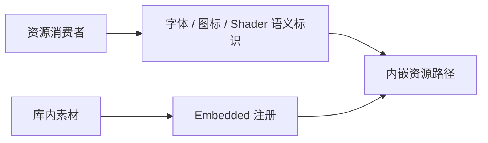
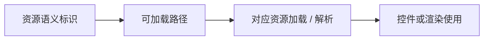

# Asset 核心设计

库内控件需要共享稳定的素材身份，但不需要知道素材存在哪个目录。Asset 将资源的物理存放、内嵌注册和语义命名集中起来，解析与使用仍属于消费者。

## 语义身份隔离文件布局

窗口关闭图标通过 `BuiltinIcon::WindowClose` 表达用途，字体和 Shader 使用各自的类型。消费者取得路径时依赖的是语义，而不是某个内部目录字符串。

不同资源类型不被压成一个混合枚举。这样，使用者能够知道自己取得的是哪类能力，而物理文件调整不需要扩散到每个控件。

## 注册不等于解析

Asset 把字节注册到 Bevy 的资源系统。字体加载、SVG 解析和 Shader 使用发生在各自消费者中，等待和失败也由那些能力解释。

因此 Asset 不依赖 Core 或具体 Widget，也不决定图标颜色和字体应用范围。上层可以共享素材，而不会把上层呈现规则反向塞进资源注册层。

## 库资源与应用资源各自拥有

应用使用 Widgetry 不意味着应用素材也属于库。品牌图片、主题角色和演示内容由应用管理，库只收纳其自身功能真实需要的资源。

两类资源通过 Bevy Asset 系统共同工作，但生命周期与命名入口仍属于各自拥有者。
