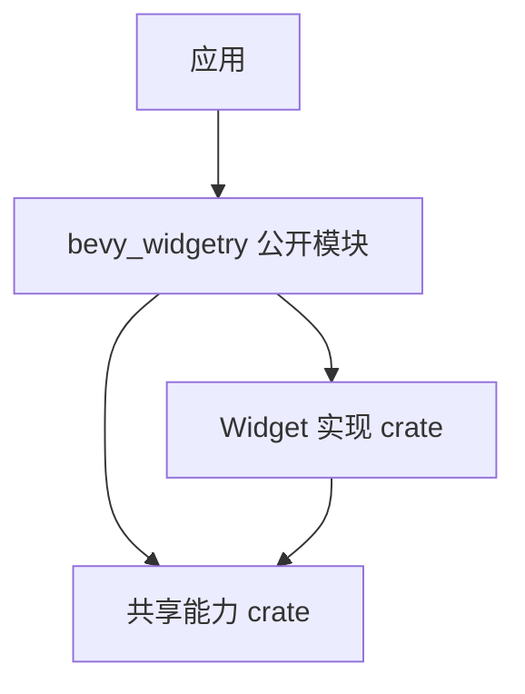

# Facade 核心设计

多个独立 crate 让实现边界清楚，却不适合把所有内部组织细节直接交给应用。`bevy_widgetry` 通过公开模块聚合能力，使调用入口统一，而实现和状态仍归原模块。

## 聚合入口，不搬迁实现

Facade 重导出控件类型、配置、状态操作与诊断。下层 Widget 和基础设施直接协作，不回头依赖 Facade。

因此，对外入口变化不意味着行为逻辑迁入顶层。应用通过 Facade 设置 Button Loading，实际状态提交仍由 Button 完成。

## 按能力选择公开范围

控件 Feature 控制相应可选依赖和公开模块，默认集合提供常用能力，应用也可以关闭它并显式选择。

编译依赖与 API 可见性是两回事：组合控件可能需要某个下层 crate，但不自动替应用开启那个 crate 的 Facade 模块。底层组合关系不会被 Feature 伪装成互不依赖的孤立实现。

## 运行时装配仍属于宿主

编译某项能力不等于创建它的资源或 UI。应用安装 Plugin、注册 Renderer、提供 Model 和处理错误；Facade 不拥有统一的业务生命周期，也不在导入时安装宿主策略。

构建期工具、测试辅助和文件适配等独立能力保持各自入口。这让顶层库既方便使用，又不会因为统一命名而吞并所有依赖与运行责任。
