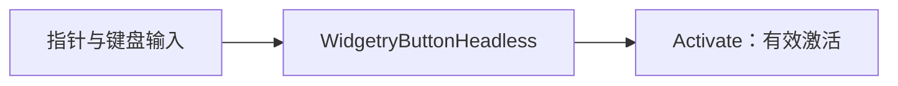
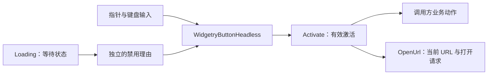
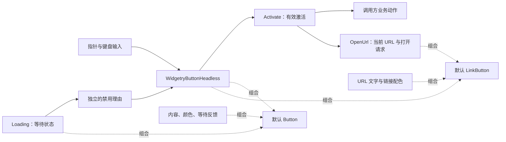

# Button 核心设计

Button 把“用户完成一次激活”作为共同基础，再将激活后的动作、临时交互限制和视觉表现分别组合。普通按钮、链接按钮与自定义按钮因此可以共享输入语义，而不必共享外观或业务动作。

## 先把输入归约为一次激活

按钮的内容可以是文字、图标或复合界面，但它们共同需要一个明确结果：用户完成了一次有效激活。

`WidgetryButtonHeadless` 将指针与键盘输入转换为 Bevy 官方 `Activate`。它保留输入归属和取消语义，不把“看起来被按下”直接等同于业务执行，也不负责业务动作。

这让交互成为可以独立使用的能力。更换文字、布局或背景不会改变激活规则；应用监听的是激活结果，而不是分别监听每一种底层输入。

## 让行为差异拥有自己的状态

统一激活后，不同按钮的差异才出现。普通按钮把事件交给调用方，OpenUrl 将它解释为打开当前 URL 的请求。Loading 则不改变激活的含义，而是限制用户能否发起下一次激活。

Loading 状态由 `WidgetryButtonLoading` 保存，URL 由 `WidgetryOpenUrlState` 保存。它们不是从 Spinner 是否显示、文字内容是什么来反推的状态。内部禁用理由通过 Core 组合，Loading 结束只撤销自己的限制。

状态提交与展示更新分开，因此默认文字或 Spinner 损坏不会撤销已经成功提交的行为状态。OpenUrl 在实际执行请求时读取当前 URL 和禁用结果，避免排队期间的旧地址或已取消目标继续生效。

## 用默认外观组成完整按钮

行为可以独立存在后，默认控件就成为一组预设组合，而不是行为的唯一载体。

`WidgetryButton` 在同一根组合 Headless、Loading 和默认 Style；`WidgetryLinkButton` 组合 Headless、OpenUrl 和链接 Style。根保持交互目标身份，内部内容与装饰由各自 Style 管理。

实线描述行为流转，虚线描述组合，不表示子控件之间互相调用。默认 Button 的内容容器在等待时隐藏，但业务内容实体仍保留；默认 LinkButton 的文字则始终投影当前 URL。

自定义外观直接组合公开能力，而不是从默认 Style 中提取或替换私有子树。这样，输入、行为状态和展示各自有清楚的归属，默认按钮与自定义按钮仍遵守同一套行为语义。
