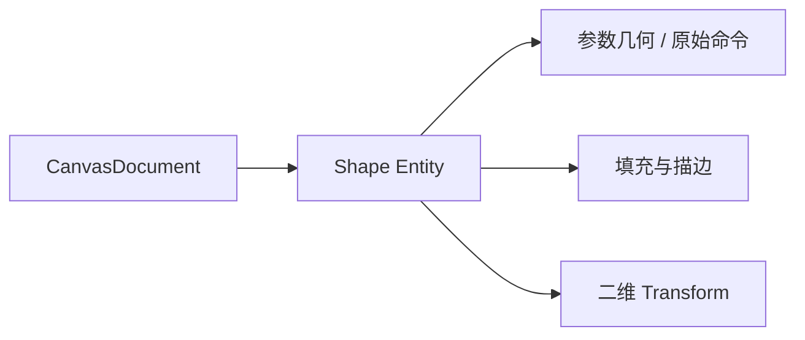
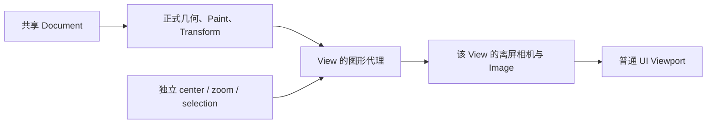
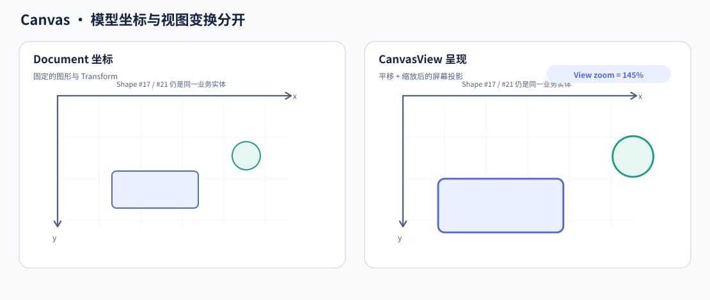
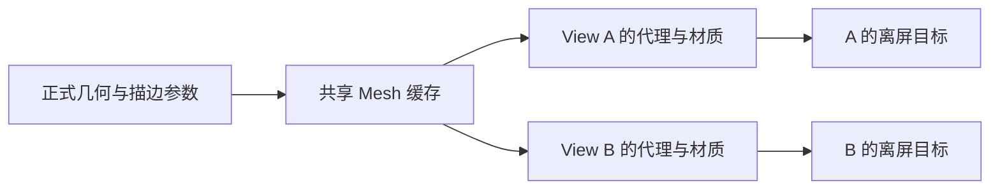
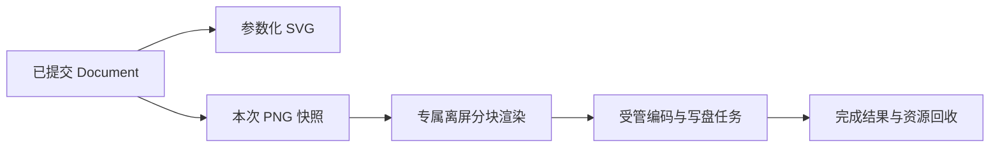

# Canvas 核心设计

Canvas 围绕一份独立的几何文档构建。观察、编辑和导出都消费这份文档，但它们不共同占有相机、视角或临时草稿。把正式图形与呈现资源分开，是多 View 编辑和独立导出能够共存的基础。

## 用参数几何保存可编辑事实

Document 中的每个 Shape 有稳定 Entity、唯一 `CanvasGeometry`、Paint、二维 Transform 和叠放位置。矩形保存宽高与圆角，椭圆保存半径，Path 保存原始命令；用于显示的细分网格不是另一份可编辑数据。

整体移动、缩放和旋转改变 Transform，参数编辑才改变 Geometry。两者作用不同，所以放大一个椭圆不会把半径永久改成屏幕像素，也不会把 Path 展平成折线。

Document 另有唯一叠放序列。显示与从顶向下的命中使用同一顺序，Transform.z 不再承担第二种排序权威。

## 为每个 View 建立独立观察空间

View 只引用 Document，并保存自己的 center、zoom、selection 和工具模式。它把 Document 坐标映射到 UI 的局部逻辑坐标，再交给独立的离屏目标。

下面的场景中，两幅画面观察同一图形，但观察位置与倍率不同。

移动 View 只改变观察；移动图形才修改共享 Document。删除 View 回收自己的相机、Image、材质和代理，不销毁 Document。Document 被删除后，View 可以保留为未绑定的空画布。

## 在共享几何和独立资源之间划清边界

多个 View 不必对相同图形重复细分。共享缓存持有由几何和描边派生的 Mesh；View 持有自己的代理、材质与离屏资源。纯 Transform 或颜色变化不重新生成局部几何。

缓存按实际代理引用保活，最后一个引用释放后才回收。选择框、控制柄和绘制预览则是当前 View 的编辑覆盖物，不进入共享 Document。

离屏呈现继续使用 Bevy 渲染能力。颜色表示转换处理预乘 Alpha 与 Viewport 合成之间的差别，但不改变几何或接管其他窗口相机。

## 让编辑手势提交到模型，而不是修改代理

输入先从窗口／UI 坐标转到 View 局部坐标，再换算为 Document 或图形局部坐标。命中检查真实填充与描边；包围框只做预筛选，不能把孔洞和曲线外部空白变成可点击面。

手势开始时固定 Pointer、目标和用途。平移提交 View 中心，整体变换提交 Document Transform，节点编辑提交 Path 命令；它们共享捕获与取消生命周期，但不共享写入对象。

绘制与移动的提交时机不同。矩形、椭圆和 Pen 的预览在完成前只存在于当前 View，取消不会留下业务图形。已存在图形的移动、缩放和节点拖动则实时提交，普通取消停止后续输入，不自动撤销先前提交。

例如，在 A 中拖动正式矩形，B 会看到位置变化；在 A 中拖出一个尚未释放的矩形草稿，B 不会看到。差别不是刷新延迟，而是前者已经属于 Document，后者尚未提交。

## 让局部与批量修改保持同一身份语义

单选编辑始终保持 Shape Entity；拓扑操作在副本上修改并校验整条 Path，成功后一次替换命令。命令下标不是稳定身份，因此拓扑变化会结束引用旧节点位置的手势。

多选平移保留每个成员的局部几何和顺序，用同一个 Document 位移更新所有 Transform。批量 API 在任何写入前校验全部成员，避免移动一半后才发现另一个对象已删除。它不创建额外 Group，也不改变各 View 的独立选择。

## 从正式文档生成独立导出

SVG 直接读取参数模型，保留几何语义；PNG 固定模型快照，再使用与 View 一致的几何管线渲染。两者都不依赖某个已有 View 的缩放、背景或控制柄。

PNG 将 GPU 渲染与后台编码连接为同一次导出：逐块读回、受背压约束地编码，不把整幅巨大 RGBA 长期放进内存。完成通知以实际任务终态为准，不以“请求已分配”或“某块已渲染”冒充文件完成。

正式模型、View 会话和导出快照因此各自具有明确生命期。它们共享几何解释，但不会互相夺取状态权威。
