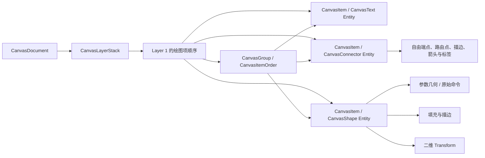
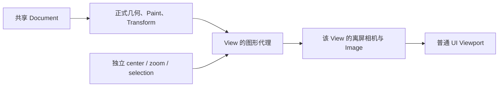
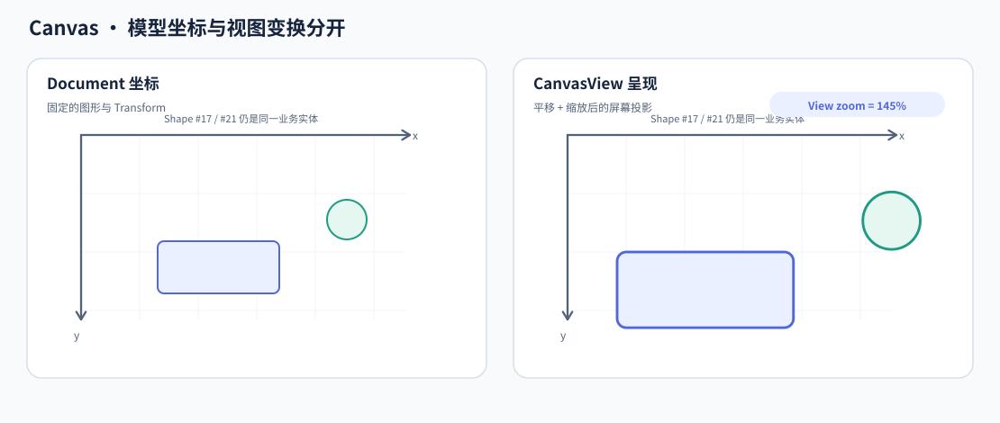
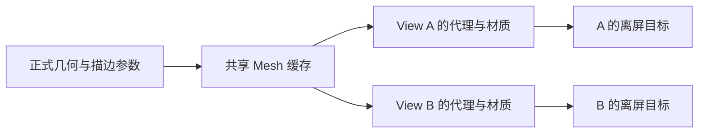
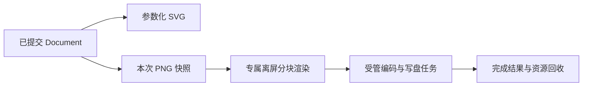

# Canvas 核心设计

Canvas 围绕一份独立的几何文档构建。观察、编辑和导出都消费这份文档，但它们不共同占有相机、视角或临时草稿。把正式图形与呈现资源分开，是多 View 编辑和独立导出能够共存的基础。

## 用参数几何保存可编辑事实

Document 中的每个 Shape 有稳定 Entity、唯一 `CanvasGeometry`、Paint、二维 Transform 和叠放位置。矩形保存宽高与圆角，椭圆保存半径，Path 保存原始命令；用于显示的细分网格不是另一份可编辑数据。

整体移动、缩放和旋转改变 Transform，参数编辑才改变 Geometry。两者作用不同，所以放大一个椭圆不会把半径永久改成屏幕像素，也不会把 Path 展平成折线。

Document 的 Required Components 包含 `Transform`、`CanvasLayerStack` 和 `CanvasHistory`。图层数据保存在 Stack 中，图层 ID 在同一 Document 内稳定。每个图层包含直属绘图项的顺序列表，容器实体通过 `CanvasItemOrder` 记录其直属子项。 `ChildOf` 负责已挂载绘图项的 ECS 所有权和级联销毁，绘图项必须同时出现在所属容器的顺序列表中。

Renderer、从顶向下的命中和导出沿图层顺序遍历绘图项，共用同一个叠放依据。Renderer 和导出读取可见图层，命中进一步只读取未锁定的可见图层。绘图项的 Transform 相对所属图层或父组。Group 允许平移、绕 Z 旋转和正数等比缩放，合成后仍可用 TRS 表示，取消分组因此可以保持成员的视觉位置和尺寸。Document 根的 Transform 不参与文档坐标计算。

每个 Group 在展平画序中占用连续范围。分组要求所选成员在父容器内连续，以保留可见项的相对位置。组原点和选择框使用实际绘制的 Path 子路径计算边界。

## 为每个 View 建立独立观察空间

View 引用 Document，并保存自己的 center、zoom、selection、活动图层、组内编辑路径、工具模式和吸附设置。它把 Document 坐标映射到 UI 的局部逻辑坐标，再交给独立的离屏目标。编辑路径将选择限制在当前容器的直属绘图项，路径之外的对象继续显示。

Document 提交图层更改后，已绑定视图重新验证选择与活动图层。活动图层变化会结束该视图正在进行的绘图草稿，后续绘制从新的活动图层开始。

下面的场景中，两幅画面观察同一图形，但观察位置与倍率不同。

移动 View 只改变观察；移动图形才修改共享 Document。删除 View 回收自己的相机、Image、材质和代理，不销毁 Document。Document 被删除后，View 可以保留为未绑定的空画布。

## 在共享几何和独立资源之间划清边界

多个 View 不必对相同图形重复细分。共享缓存持有由几何和描边派生的 Mesh；View 持有自己的代理、材质与离屏资源。纯 Transform 或颜色变化不重新生成局部几何。

Renderer 在每个 View 下建立与 Document 一致的组代理树，Bevy 将局部变换传播到图形代理。绘制深度仍由展平后的顺序给出。模型侧按相同的根到叶顺序相乘 Bevy 仿射矩阵，供命中、边界、编辑和 SVG 导出使用。编辑手势按需将文档坐标转回父组或图形局部坐标。

分组和取消分组提交前检查每个后代的文档投影。矩形、椭圆和直线子路径按绘制轮廓计算位移范围。曲线子路径使用源命令的投影极值及描边包络，涵盖落在渲染网格顶点之间的 SVG 曲线点。只有移动命令的子路径没有绘制轮廓。

缓存按实际代理引用保活，最后一个引用释放后才回收。选择框、控制柄和绘制预览则是当前 View 的编辑覆盖物，不进入共享 Document。

离屏呈现继续使用 Bevy 渲染能力。颜色表示转换处理预乘 Alpha 与 Viewport 合成之间的差别，但不改变几何或接管其他窗口相机。

## 让编辑手势提交到模型，而不是修改代理

输入先从窗口／UI 坐标转到 View 局部坐标，再换算为 Document 或图形局部坐标。命中检查真实填充与描边；包围框只做预筛选，不能把孔洞和曲线外部空白变成可点击面。

手势开始时固定 Pointer、目标和用途。平移提交 View 中心，整体变换提交 Document Transform，节点编辑提交 Path 命令；它们共享捕获与取消生命周期，但不共享写入对象。

绘制与移动的提交时机不同。矩形、椭圆、直线、折线、多边形和 Pen 的预览在完成前只存在于当前 View，取消不会留下业务图形。已存在图形的移动、缩放和节点拖动则实时提交，普通取消停止后续输入，不自动撤销先前提交。

流程图预设按局部外接框生成普通 Rectangle 或 Path。View 的绘制手势持有预设类型，预览与提交共用同一轮廓构造。Document 保存最终 Geometry、Transform 和 Paint，命中、节点编辑、分组与导出沿用对应图形类型的管线。

参数化工具沿用 View 的拖动捕获，草稿持有工具参数、起点和当前指针点。正多边形与星形以按下位置为局部原点，圆弧以弦中点为局部原点。预览与释放共用放置计算和 Path 命令生成逻辑。释放时才将局部 Path、Transform 和 Paint 提交到原绘制容器，后续编辑、复制和导出只需读取普通 Path。

直线与矩形、椭圆共用拖动捕获，在释放时以起终点生成两点 Path。折线和多边形复用同一捕获和释放流程来确认点击，在 View 上保存顶点及原绘制容器，并使用 Pen 的 Path 和锚点预览资源。悬停点构成候选线段，Enter 或双击只把确认顶点提交成正式 Path。三种工具均走同一 Document 绘制入口，组内坐标转换和历史记录沿用现有提交规则。

例如，在 A 中拖动正式矩形，B 会看到位置变化；在 A 中拖出一个尚未释放的矩形草稿，B 不会看到。差别不是刷新延迟，而是前者已经属于 Document，后者尚未提交。

## 让局部与批量修改保持同一身份语义

单选编辑始终保持 Shape Entity。拓扑操作在副本上修改并校验整条 Path，成功后一次替换命令。节点拖动持有文档写入事务，其他拓扑写入须等手势结束。

多选平移保留每个成员的局部几何和顺序，用同一个 Document 位移更新所有 Transform。组内手势先把位移换算到父组坐标。批量 API 在任何写入前校验全部成员，避免移动一半后才发现另一个对象已删除。

### 用文档差异回放已提交编辑

`CanvasHistory` 只保存实际变更的组件值、图层属性和容器顺序区间。一次拖动为每个受影响的属性记录初始值，在结束时读取最终值。图层 ID 的分配序号持续递增，历史回放只恢复图层本身、默认图层和画序。

删除从原容器移除绘图项，由文档登记并保留带 `CanvasTombstone` 标记的实体。保留的组仍拥有未被拆分的后代。回放先校验受影响的画序和实体，再恢复层级和组件。保留引用随撤销或重做条目转移，条目退出历史后释放无引用的 tombstone。Document 销毁会清理正常子项和保留实体。

每份 Document 同时开放一个写入事务。手势的更新和显式复合操作都用 token 验证写入权限。Renderer 仍消费每帧实际文档组件，撤销和重做只改写正式模型，View 的无效本地状态继续走修复流程。

## 从正式文档生成独立导出

SVG 从参数模型写出几何和文档仿射矩阵。坐标、尺寸和矩阵按双精度格式写出，浏览器读取后保留模型的数值。PNG 固定图形和组的局部变换，在临时渲染场景中重建组层级，两条渲染路径均由 Bevy 按同一层级传播变换。导出使用文档坐标和已提交的绘图项。

PNG 将 GPU 渲染与后台编码连接为同一次导出：逐块读回、受背压约束地编码，不把整幅巨大 RGBA 长期放进内存。完成通知以实际任务终态为准，不以“请求已分配”或“某块已渲染”冒充文件完成。

正式模型、View 会话和导出快照因此各自具有明确生命期。它们共享几何解释，但不会互相夺取状态权威。

## 文字项的排版和投影

`CanvasText` 保存单样式文本、排版尺寸和各行基线。`create_text` 和 `update_text` 使用内置默认字体与 Bevy TextPipeline 按文档单位排版。命中和选择框使用排版矩形与字形墨迹的并集（局部原点位于排版矩形中心），然后合成组和绘图项变换。每个 View 通过独立的 `Text2d` 代理显示文字，沿绘制顺序与形状交错。宿主保存编辑草稿，属性提交进入文档历史。SVG 使用行基线生成 tspan，并附带字体；PNG 对请求快照创建文字代理，在字形图集就绪后捕获。

## 连接线的路由和投影

`CanvasConnector` 保存局部坐标中的起点、终点和手动路由点，Transform 把整个绘图项放入直属容器。组内绘制将指针确认的文档坐标换算为父组局部坐标，同时换算描边宽度。分组和取消分组通过组合 Transform 保留已提交路线、箭头和标签的文档投影。

细分阶段从路由派生开放描边路径，用首尾非零线段的切线生成实心三角箭头。共享 Mesh Cache 分别保存箭头填充和路由描边，参与真实网格命中。可选标签使用默认字体排版，中心沿路由累计长度定位，并随 Connector 一起管理画序、复制、删除和历史。分组测量投影后的描边、箭头网格和标签边界。文档中只创建一个绘图项，View 和 PNG 渲染为标签生成独立文字代理。

Connector 工具复用多点绘制会话。当前 View 持有确认点和悬停预览，提交时将全部确认点写入一条 Connector。节点编辑复用单次拖动的文档写入事务，每个手柄对应原始路由上的一个点。SVG 从同一几何解释写出描边、三角箭头和文字，PNG 使用 Renderer 的细分及文字排版。

Connector 的附着端点记录目标形状和方向。Document 用 Shape 和 Connector 各自的层级投影解析路由，位姿和几何编辑在写入前校验派生路线。显示、命中、标签定位和导出共用解析后的路由。中间点保持原有局部坐标。目标删除或失去相应锚点时，该端保留最后的局部坐标，关系变更进入同一历史条目。目标层的可见性同步到 Connector 的显示条件。View 为零长度路线投影可选中的临时标记。

## 局部视图网格

网格 Mesh 挂在 View 的离屏相机下，深度位于图形之后，并使用该相机专属的 Render Layer。Renderer 在布局完成后使用视口尺寸与 Zoom 计算可见线。相机相对坐标和文档原点相位共同确定网格位置。密度过高时按网格周期抽取线条，每个轴限制生成线数。视口、相位相关输入或设置变化时更新同一 Mesh，关闭显示或销毁视图时释放资源。

## 对象吸附与参考线

吸附沿可见图层的绘制顺序遍历绘图项。每个叶项使用层级变换解析后的文档 AABB，Group 聚合其后代边界。路径锚点来自源命令的端点。选择中项目及其子树从候选中排除，包含选择的祖先组不贡献聚合边界。候选以文档距离排序，缩放将逻辑像素容差投影到同一坐标系。

Path 锚点匹配二维位置。普通对齐选择两个轴各自的边缘或中心候选，移动时用选择边界的预测位置进行匹配。View 的拖动状态按候选身份保留滞回，参考线从当前匹配投影到该 View 的离屏相机。Document 操作只接收最终坐标，Guide Mesh 的生命周期跟随交互与 View。

输入转换得到待写入的文档坐标后，用基础间距和当前 Zoom 计算吸附。移动与节点编辑先考虑抓取偏移，组内手势把吸附的文档位移换算回局部坐标。渲染密度与吸附步长分别由 View 投影和配置决定。Document 历史仅记录手势产生的模型变化。
