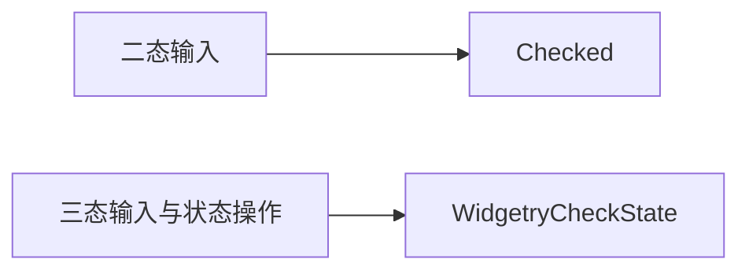
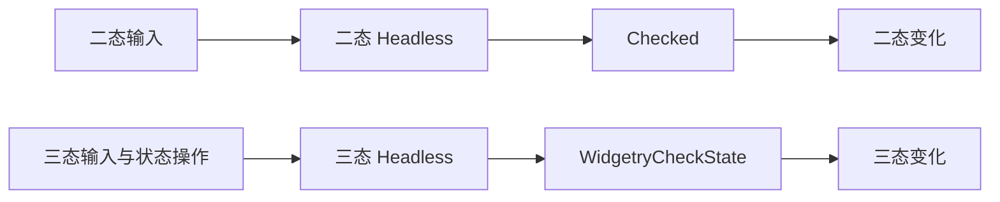
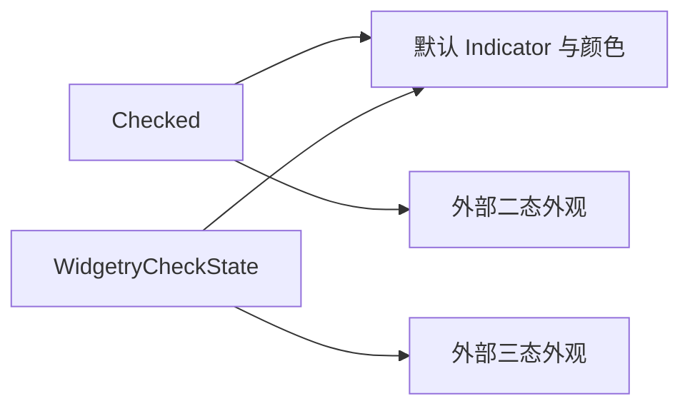

# CheckBox 核心设计

CheckBox 包含二态和三态两种语义。二态沿用 Bevy 的 Checked，三态保存 WidgetryCheckState。它们可以共享外观部件，却不把不同的状态模型硬塞进同一份数据。

## 从两种选择语义出发

二态只回答是否选中，原生 Checked 已能完整表达。三态还需要表达部分选中；把它编码为额外视觉标记会让业务必须读取画面才能判断状态。

因此，两套行为分别拥有自己的权威。三态的 Indeterminate 是正式状态，不是颜色异常，也不是 Disabled。业务汇总子项后可以提交这个状态，控件本身不承担应用的选择集合模型。

## 让输入作用于所属状态

二态 Headless 组合原生 Checkbox 输入，并只为自身身份处理相应的状态请求。三态 Headless 管理自己的状态循环与提交后通知。两者不因为共用一个 Plugin 就共同接管所有原生 Checkbox。

默认控件与外部样式使用同一份行为状态，不借助默认 Indicator 才能完成输入。禁用影响操作资格，不修改已选中或部分选中的含义。

## 在保留状态差异的同时复用表现

默认 Style 为两种行为生成方框、勾选或部分选中标记，并结合主题和交互状态更新颜色。共享的是视觉表达能力，不是业务状态的存储。

例如，一个父级项目可以显示部分选中，但子项目仍然各自保存 Checked。父级的横线只是父级三态的投影，不是由绘制系统反向控制所有子项。这样，组合选择逻辑留在业务层，基础勾选行为和视觉部件都能独立复用。
