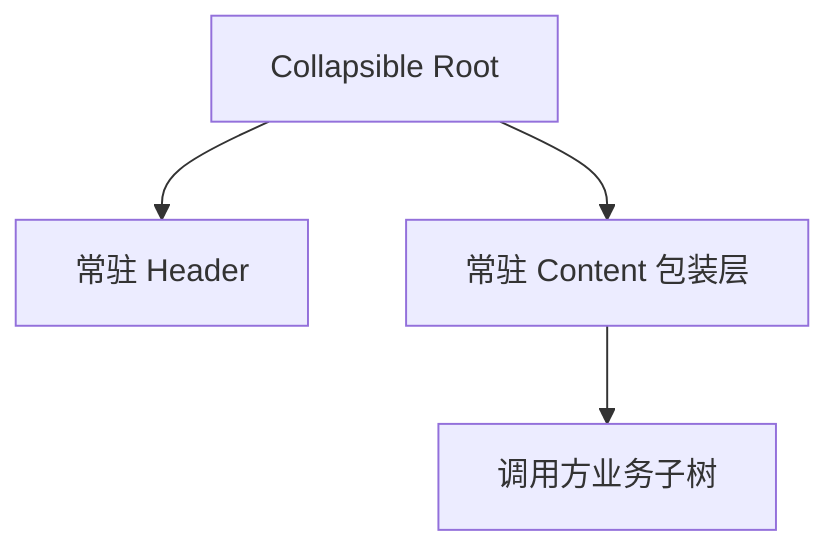
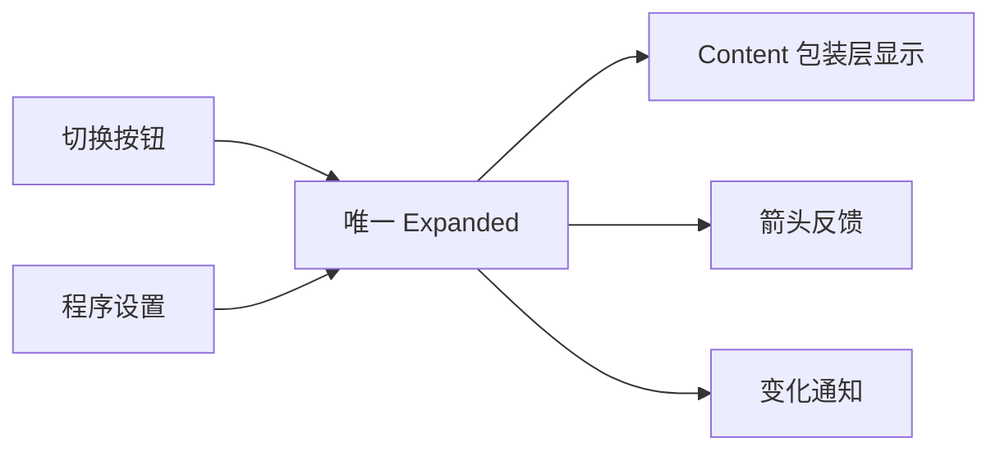

# Collapsible 核心设计

Collapsible 把“内容是否展开”与“内容是否存在”分开。唯一 Expanded 决定包装层展示，Header 与 Content 始终常驻，按钮和箭头只是这个状态的操作入口与反馈。

## 先保留稳定的内容身份

折叠常用于表单和设置区域。如果每次收起都销毁内容，重新展开就会丢失编辑器草稿、滚动位置或绑定的业务实体。

因此，构造只建立一次结构。Header 的业务内容与末端切换按钮共同组成标题行，Content 接受调用方内容；折叠不是一个新的构造周期。

## 用唯一 Expanded 驱动展示

按钮输入和程序设置都提交到根上的 Expanded。提交后再更新内容可见性、箭头和必要焦点处理，并发出变化通知。

包装层隐藏不会改写后代原有的显式 Visibility、布局和数据。展开时恢复包装层，让业务内容继续从自身状态显示，而不是拿一份构造初值覆盖当前数据。

## 将组合控件的职责留在组合处

Collapsible 复用 Button 的瞬时交互和 Icon 的显示，但 Expanded 不属于按钮，业务内容也不属于 Icon。卡片负责自己的配色与结构，子能力继续管理自己的输入和视觉部分。

例如用户在备注框中输入半段文字后折叠区域，展开时应看到原草稿；但隐藏期间的保存任务是否继续，不由折叠控件决定。这里保留的是 UI 子树身份，不是替业务暂停执行。

这样的组合允许 Header 与 Content 独立丰富，又不需要为内容建立一套生命周期镜像。
