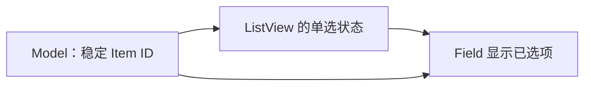
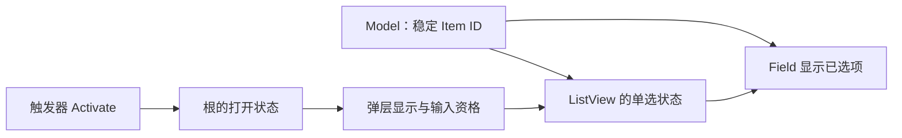
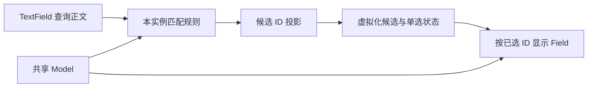
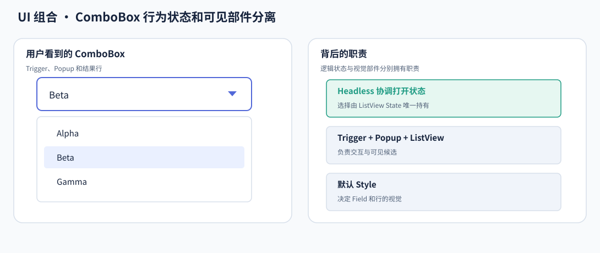

# ComboBox 核心设计

ComboBox 不是同时保存一份 Field 选择和一份 Popup 选择，而是围绕一份稳定身份的选择组织两个展示位置。数据仍在列表 Model 中，Field 表示已提交结果，Popup 提供寻找和提交新结果的交互。

## 先让展示与列表指向同一个选择

Model 保存业务项，内部 ListView 的单选状态是选择权威。Field 通过选中 ID 读取业务值，不从某个临时行实体反推内容。

因此，行重新排序不改变选中对象，弹层关闭也不清除选择。默认初始为空，Placeholder 表达“尚未选择”，而不是隐式替业务选择第一项。

## 在同一根内组织打开会话

选择之外，ComboBox 还需要一段弹层会话。根持有逻辑打开状态，Trigger、Popup 和 List 通过显式绑定参与这一会话，默认布局只是其中一种组织。

绑定允许装饰层嵌套，却保持同一根的生命周期边界。Popup 外的 Trigger 与 Popup 内的 List 不会因视觉结构变化而丢失语义身份。

关闭不仅隐藏 UI，还撤销弹层输入资格并处理它拥有的焦点。否则隐藏列表仍可能消费已经排队的确认动作。Escape 和外部点击具有不同焦点意图，前者返回 Trigger，后者保留新目标。

## 把搜索加入显示投影，而不是加入业务数据

搜索编辑器的正文由 TextField 持有。Matcher 根据正文生成当前 ComboBox 的稳定 ID 投影，ListView 使用这一投影显示候选。

观察下图中的部件关系：搜索改变候选区域，Field 仍对应正式选择。

当查询暂时隐藏已选项时，不存在业务删除，因而 Field 和选择仍保留。关闭后清查询也只是重建候选范围。只有 Model 真正删除身份，才清理失效选择。

## 让默认外观与独立行为共享同一条路径

默认 ComboBox 组合上述 Headless、显式部件绑定、Renderer 和配色。外部 Style 也通过同一绑定使用行为，而不是再实现一套开关或选择状态。

视觉层管理尺寸、颜色、内容与显示；行为层管理 Source、选择协调、打开会话与输入资格。它们交界于明确的状态和部件身份，所以主题更新不重置搜索草稿，弹层重绘也不会生成第二份选择。
