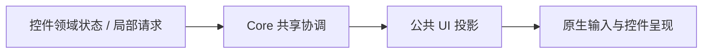
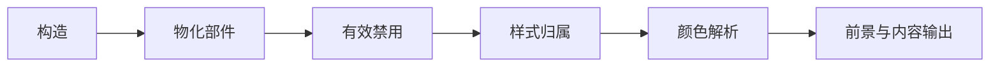

# Core 核心设计

控件共享许多 UI 语义，但不共享同一份业务模型。Core 因此承载跨控件的协调机制，而不是集中保存所有控件状态或建立另一套 UI Runtime。

## 让控件表达请求，而不是争写公共结果

Disabled、Pointer Hover 和前景传播都存在多个参与者。若每个控件各自遍历层级、写入公共输出，组合后就容易出现相互覆盖或顺序不一致。

Core 接收这些参与者能够表达的局部信息，再维护共同的派生结果。禁用来源仍归各控件，颜色仍由实际样式拥有者决定，输入的业务含义也不转移到 Core。

这里统一的是协作规则，不是把所有可复用代码都塞进一个模块。Theme、Cursor、Diagnostics 和 Job 继续具有自己的职责。

## 把公共结果接回 Bevy

有效禁用映射到原生交互标记，Hover 进入官方状态，内容颜色应用到明确参与的文本与图标。这样的适配让控件能够继续使用普通 Query、Observer 和 UI 实体。

组件的逻辑根、实际输入目标与视觉子树可以不同。Core 保存必要的关联信息，但不把 TextField 的编辑状态或 ComboBox 的选择复制到公共层。

## 用阶段顺序连接构造与呈现

动态控件可能在运行中创建子结构。如果颜色消费早于部件物化，或者输入派发早于禁用同步，就会出现一帧不一致。

Core 提供与 Bevy 调度衔接的阶段，而不是接管所有系统。各控件在相应阶段更新自己拥有的输出，稳定状态不需要反复重建关系。

## 公共资源只回收自己拥有的部分

Scene 适配保留构造失败及原始错误身份；离屏设施管理专属目标与层号；字体和 Icon 提供公共内容能力。它们各自拥有明确的资源边界，不因为某个 UI 失败就删除外部业务实体或宿主共享资产。

例如 CanvasView 销毁后公共离屏目标可以回收，但 CanvasDocument 仍然存在；它不是渲染目标的附属对象。具体协议分别放在 [Disabled](../mechanisms/disabled.md)、[离屏渲染](../mechanisms/offscreen-rendering.md) 等机制文档中。
