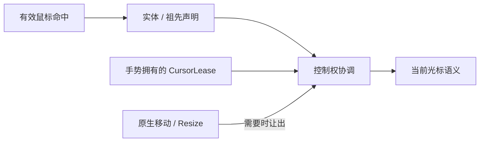

# Cursor 核心设计

控件知道用户正在做什么，窗口最终只能显示一个系统光标。Cursor 把“语义声明”“当前控制权”和“图像呈现”分开，避免每个控件直接争写窗口状态。

## 从命中关系取得语义

控件把系统语义或扩展 Hint 声明在实体上。解析沿命中实体及其层级寻找适用声明，选择结果仍是“可点击”“只读”“等待”等含义，而不是固定图片。

因此，自定义外观可以改变光标主题，却不要求每个控件认识具体角色素材或图集。

## 让手势拥有临时控制权

拖拽离开原命中区域后，光标仍应表达正在执行的操作。带拥有者的 Lease 让活动手势临时固定语义，结束时只释放自己的控制权。

Touch、Custom Pointer 与真实鼠标的身份不能混用。原生窗口操作接管光标时，库不会持续覆盖系统正在提供的反馈。

## 将语义映射为可替换的呈现

主题将语义映射为系统光标、静态图像或图集动画。缺项回退原语义，外部素材的加载失败也不会使基本反馈消失。

动画拥有帧区域、时长和热点，预览与原生播放使用同一份定义。热点相对于帧区域，不随着图集排列改变实际作用点。

颜色 Theme 与 CursorTheme 彼此独立；改变控件颜色并不隐含切换指针图片。图库、主题名称和选择菜单归应用，Cursor 只维护语义到呈现的关系及其生命周期。
