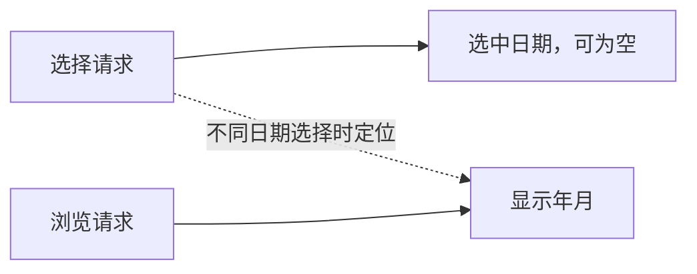
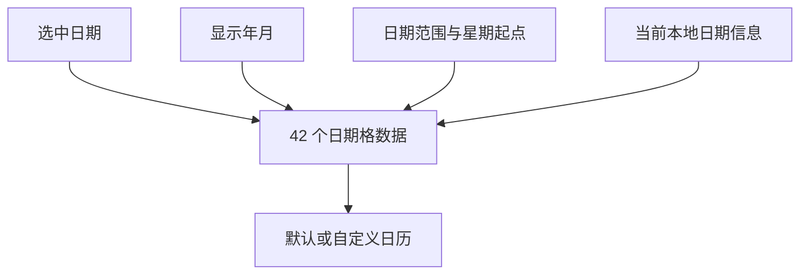
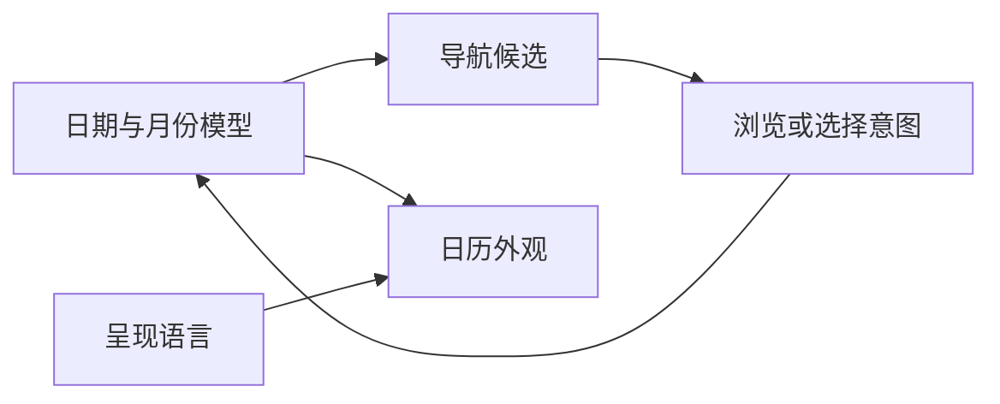

# DatePicker 核心设计

DatePicker 从两个不同的问题出发：用户选中了哪一天，以及当前正在看哪一个月。设计分别保存这两项状态，再由日期模型生成格子和导航候选；画面上的数字不是状态来源。

## 把选择与浏览分开

若用一个日期同时代表选择和视口，翻月就会悄悄改变业务值，清空选择也会失去当前浏览位置。DatePicker 因此保存 `Option<Date>` 与 `DatePickerMonth` 两项独立状态。

选择新日期可以带动月份定位，但普通浏览只改月份。清空选择不清空浏览位置，同值选择也不撤销用户刚刚翻到的月份。两项变化分别通知，避免业务把导航误认为提交。

## 用真实日期派生日历格

日期区域从月份和星期起点推导出固定 42 个连续真实日期，再附加本月、范围、选择与 Today 标识。

格子只是一份派生结果，不保存第二份选择。十一月画面中出现的十月末日期仍然有完整 Date 身份，所以点击邻月格、判断范围与切换月份都使用同一日期语义。

范围约束选择而非浏览。这样日历可以展示范围之外的月份，同时明确哪些日期不可选，而不是通过省略数据隐藏范围边界。

## 让导航和语言保持呈现职责

导航能力管理视图和候选，最终日期选择仍回到同一日期模型。语言配置仅改变月份、星期和其他标签的表达，不改变日期计算。

Today 也是独立输入，不等同于自动选择。当本地时钟暂不可用时，不伪造“今天已经被选中”；显示月份可以有明确回退，而选择仍保留真实业务状态。

默认控件与外部日历由此共享日期规则、变化通知和范围校验。不同外观可以使用方格、卡片或不同导航层级，却不需要重新实现日历状态权威。
