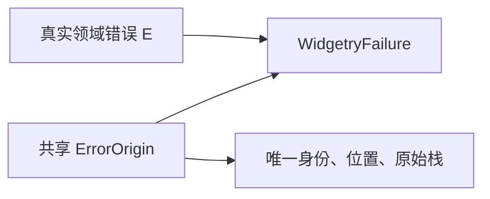
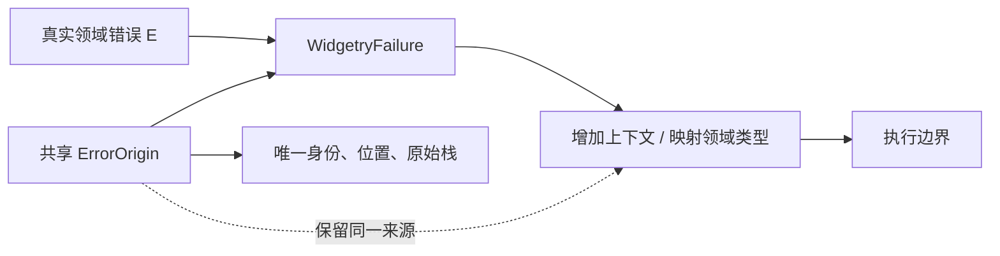
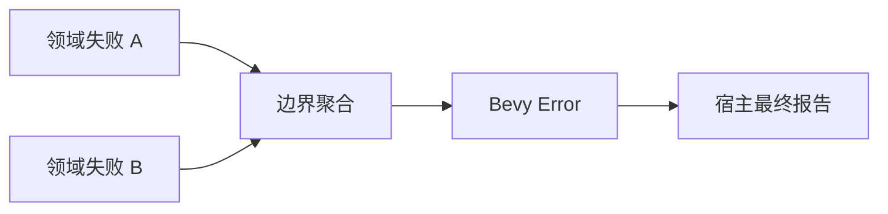

# Diagnostics 核心设计

错误经过多个控件和执行边界后，仍应能回答“最初发生了什么、经过哪里、最终如何处理”。Diagnostics 将错误的来源身份与传播上下文分开，使包装和转交不会把一次失败变成多次无关事件。

## 先保存具体原因，再建立来源身份

领域错误保存可匹配的类别和原始参数，标准 source 链保留下层原因。`WidgetryFailure<E>` 在首次接管真实失败时建立共享 `ErrorOrigin`，记录身份、调用位置与原线程回溯。

错误的可读描述不替代类型和原因链。相同文案可以来自两次不同操作；它们应拥有不同身份。反过来，一次失败经过多层包装，仍然只有一个来源。

## 传播改变语境，不改变起点

上层可能需要补充控件根、请求号或操作阶段，也可能把下层类别映射成自己的领域类别。这些变化属于传播语境，不意味着失败重新发生。

例如 TextField 的失败被 NumberInput 消费时，后者增加数值根和编辑操作信息，但不重新创造“NumberInput 源头错误”。跨线程转交同样保留首次纳入的栈，而不是用接收线程的栈覆盖它。

## 领域载体与 ECS 适配分开

底层载体不依赖 UI 或 ECS，也不安装日志接收器。构建工具、普通后台代码和控件可以使用同一种失败结构。

Bevy 适配负责把一个或多个诊断交给执行边界。聚合并不合并来源：多个控件失败仍分别保存原因和身份，原生 Bevy 错误也保留其原对象与严重级别。

这样，批量处理不会因为先遇到一个坏实例，就丢掉其余失败或停止健康实例的更新。

## 故障持续与错误处理是不同维度

持续故障由实际拥有者按业务键保存。重复观察复用同一身份，重新验证成功才算恢复；对象销毁只是结束拥有关系。

处理则表示某一层确实采取了回退、终止或提示措施。处理记录不执行这些动作，也不自动清空持续状态。最终报告由宿主完成，诊断对象在最后一个拥有者释放后正常销毁。

因此，来源、传播、处理、恢复和终结报告可以关联到同一失败，却不会被压成一个模糊的“已经记录过错误”。
