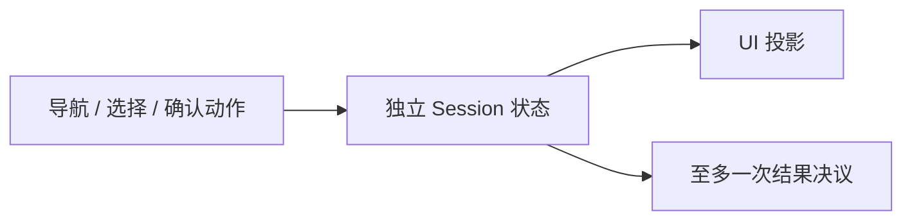
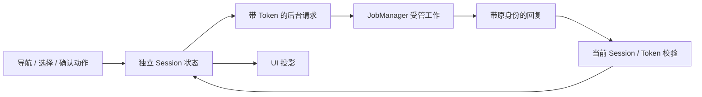
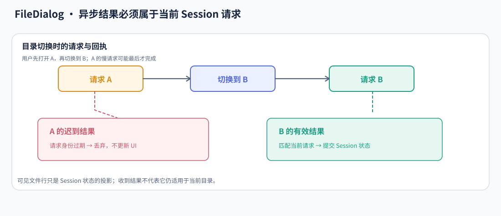
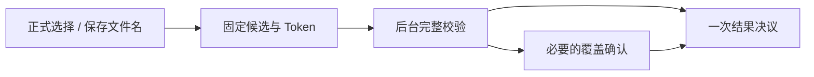

# FileDialog 核心设计

FileDialog 把文件选择看作一段有身份的业务会话，而不是一张包含目录列表的窗口。目录读取、用户选择、候选确认和界面显示都围绕同一 Session 协作；窗口只是它的一种承载方式。

## 先确定一次选择会话的边界

每次构造创建独立 Session，保存模式、目录、选择、候选与结果。嵌入式内容和独立窗口使用同一业务状态，不因换了外壳就改变确认语义。

结果属于 Session，不属于某个确认按钮。用户取消、窗口关闭和成功确认都通过会话决议汇合，避免多个入口重复发送结果。SaveFile 的决议是路径，不是替应用完成写盘。

## 把后台结果绑定到产生它的请求

文件系统操作不能在 UI 主线程中阻塞，但后台结果可能晚于新的用户意图。Session ID 只能区分不同会话，还不足以区分同一会话内先后浏览的目录与查询。

因此，请求携带目录 generation、query revision、edit revision 和 selection revision 等身份。回复被当前 Session / Token 接受后，才能修改正式状态。

下面的场景中，用户已经从 A 切换到 B，A 的结果才到达。

A 的结果可能完全正确，却已经不属于当前操作。拒绝它不是文件系统错误，而是防止旧请求覆盖新意图。取消也不必等待旧 I/O 结束，业务会话可以先失效，后台再按自己的生命周期收尾。

## 在目录快照上建立独立投影与选择

目录条目保留原始 PathBuf 和稳定 EntryId；Search、Filter、Sort 产生显示投影。物理行只是投影的可见部分，滚动复用不会改变业务身份。

Selection、Active 和范围 Anchor 分开保存。Active 表示当前浏览位置，Selection 表示准备确认的集合；Ctrl+A 冻结当时已到达条目的范围，不因后续目录批次到达而无声扩大用户选择。

选择准备和大规模投影也可以在后台完成，但它们仍按请求顺序和 Token 提交。界面没有第二份“看起来已经选中”的权威状态，Confirm 会等待相关准备完成。

## 将确认拆成候选、验证和决议

选中一条可见记录不意味着它此刻仍是可接受的文件。确认先固定候选，再在后台校验完整路径集合和模式要求，必要时进入覆盖确认。

覆盖回答针对固定候选，不能因为用户随后改了文件名就授权另一个目标。等待验证期间的新导航、编辑或取消会使旧候选失效，最终决议仍属于当前 Session。

## 区分共享偏好与会话内的视觉缓存

Storage Scope 允许多个 Session 共享偏好，但每次选择会话仍独立。持久化把已提交偏好异步写盘，磁盘写入完成与内存状态提交不是同一时刻。

系统图标则属于展示缓存，不是文件身份或选择结果。回复先进入所属 Session / generation 的缓存，再根据当前行绑定投影；一行被复用后，旧图标不会落到另一个文件上。

样式、图标和窗口协调不重新解释业务选择。它们消费已提交状态，因此换色、缩放或暂时无法取得图标都不需要重开 Session，也不会撤销已有的合法候选。
