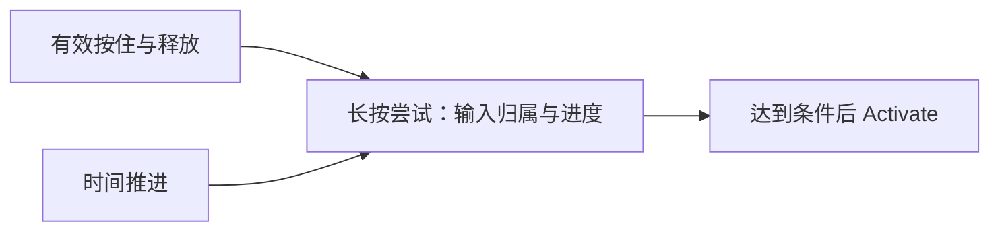
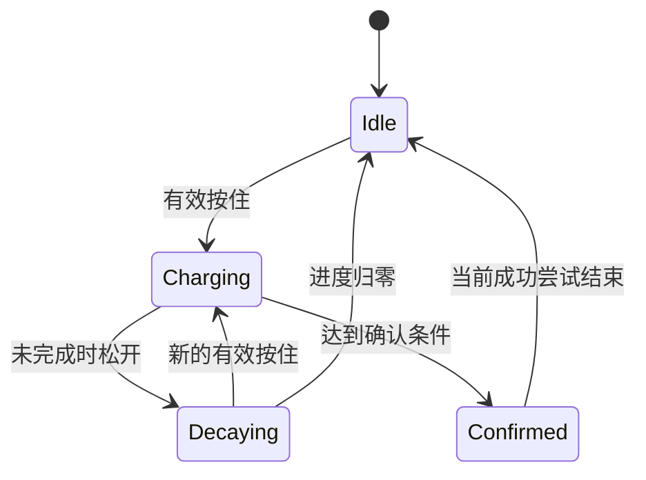
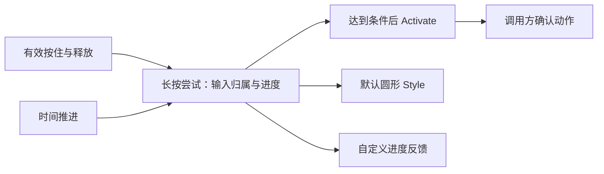

# HoldButton 核心设计

HoldButton 的确认条件不是一次点击，而是一个连续、可取消的长按过程。设计首先保存这次尝试的输入归属和进度，再把它投影成默认圆形外观；充能动画不能反过来决定业务是否成功。

## 让一次尝试跨越多帧存在

点击可以在离散事件中完成，长按则必须判断多个时间点是否属于同一次连续输入。Headless 因此管理尝试状态、计时和取消，而不是让视觉系统自行累加一个看起来像进度的数。

进度只描述当前确认过程。提前松开和有效取消与成功有不同含义，持续按住也不意味着持续重复执行。成功锁存把一次尝试与一次激活对应起来，使调用方不必自行去重每一帧的完成状态。

## 把充能和衰减留在同一行为中

未完成的尝试结束后，进度可以按配置衰减。充能时长和衰减时长属于行为参数，因为它们改变确认过程，而不是只改变动画速度。

图表达确认过程的概念状态，不要求外观采用这些名称。失焦、禁用和输入取消由行为层收尾，默认材质无需知道 Pointer 的每个原始事件。

## 将过程投影为可替换的反馈

默认 HoldButton 在同一根组合 Headless 与圆形 Style。行为提供进度和成功结果，Style 负责材质、阴影、内容和动画呈现，并按需要请求重绘。

同样两秒的确认可以显示成圆形填充，也可以显示成横向进度条。改变的是进度表达，不是达到阈值的时机、取消语义或成功次数。默认视觉缺失属于展示故障，外部组合不需要构造这些私有视觉部件。
