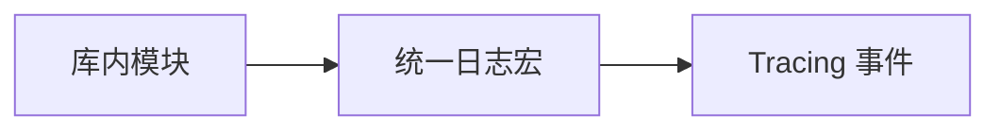
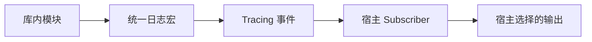

# Internal Log 核心设计

内部日志层只统一记录入口，不替应用决定记录如何被接收。库可以稳定地发出生命周期信息，同时不强迫宿主采用某个输出目标或日志格式。

## 在发出端统一身份

各模块使用同一组宏，把事件发送到 `bevy_widgetry` Target。等级和结构化字段仍采用 Tracing 的语义，调用位置保留在真正发生事件的地方。

这里不保存业务日志队列，也不维护某个控件是否已经报错的状态。是否应该产生一条记录，由事件的实际拥有者判断；诊断身份与持续故障则由 Diagnostics 管理。

## 把输出选择留给宿主

发出的事件进入宿主已有的 Subscriber。过滤、格式、终端与文件输出都在接收端决定，因此库无需知道应用是否有窗口或如何关闭日志文件。

这一层只依赖 Tracing，可以同时被运行期控件和不依赖 UI 的工具使用。日志记录与错误返回保持独立：发出一条消息不会代替调用方的错误处理，也不会改变业务操作的结果。
