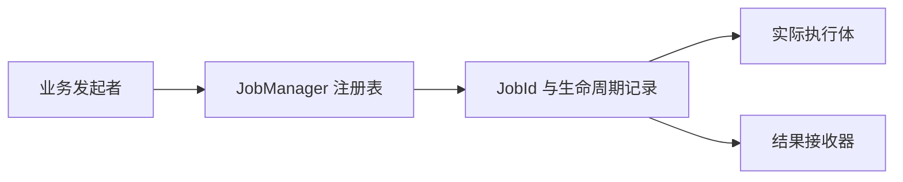
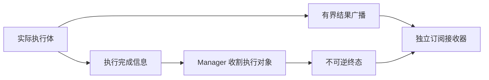
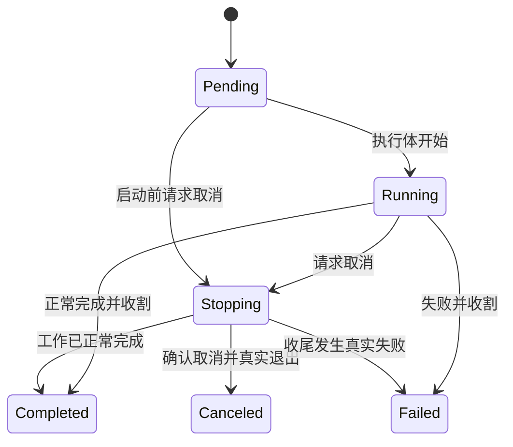

# Job 核心设计

后台任务需要的不只是“启动一段异步代码”，还需要知道它何时真正结束、结果由谁接收、取消后谁负责收尾。Job 将这些生命周期问题集中在实例级 Manager 中，业务闭包仍负责具体工作和业务结果。

## 用一个注册表连接执行与观察

每个 Job 在启动前获得身份、状态记录和首个结果接收器。Manager 持有执行对象，调用方通过 JobId 观察同一个任务；克隆 Manager 共享注册表，不产生第二份生命周期。

I/O Future、CPU Future 和专属线程采用不同执行载体，但保留同一控制语义。任务记录在终态后仍然存在，直到调用方明确移除；完成与遗忘因此是两个不同动作。

## 把数据流与任务结束分开

任务可能在结束前发送多批数据，也可能没有任何数据。不能靠“队列现在是空的”判断它已经完成。

结果通道保存有界数据，每个订阅者持有独立读取位置。任务终态另行保存，接收器排空自己的数据后才交付 Finished。即使数据缓冲已满，任务结束的事实仍能被记录。

慢订阅者产生背压，而不是默默覆盖未读数据。新订阅从注册时刻开始，不把通道变成历史数据库。业务结果通过 Arc 共享，数据的持有时间由实际消费者决定。

## 取消必须由工作体完成

Manager 能提出取消，但不能知道业务代码何时到达安全停止点。任务因此区分取消请求、取消确认和真实退出。

一个正在阻塞读取的线程，收到取消后可能仍停留在操作系统调用中。此时界面可以不再需要它的结果，但任务不能提前宣称 Canceled；只有读取结束、收尾完成、线程 Join 后，资源才真正离开活动状态。

取消也不掩盖错误。收尾失败仍进入 Failed；已经完成的工作不会被迟到取消改写为另一种终态。

## 关闭协调不接管业务结果

全局关闭先停止新任务接纳，再统一请求已有任务取消并观察其退出。超时描述等待条件，不伪造完成，也不强制拆除执行体仍在使用的对象。

任务发起者仍然拥有结果解释权。FileDialog 的目录请求是否过期、Waveform 的计算是否还匹配当前窗口，都不是 Manager 能决定的。**Job 完成说明工作已经结束；业务身份校验决定结果是否还能提交。**

这一分工使同一任务设施可以服务短计算和长期服务线程，而无需理解控件的会话与视图状态。
