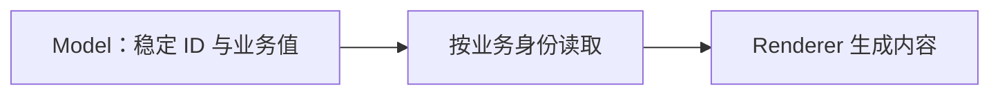
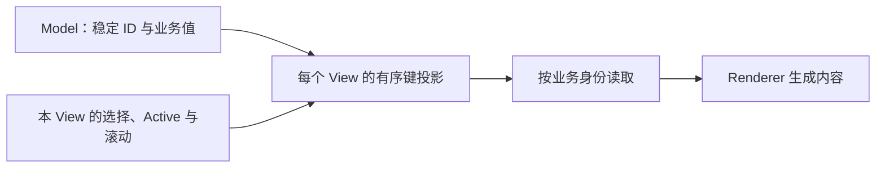
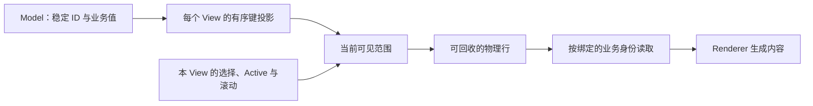
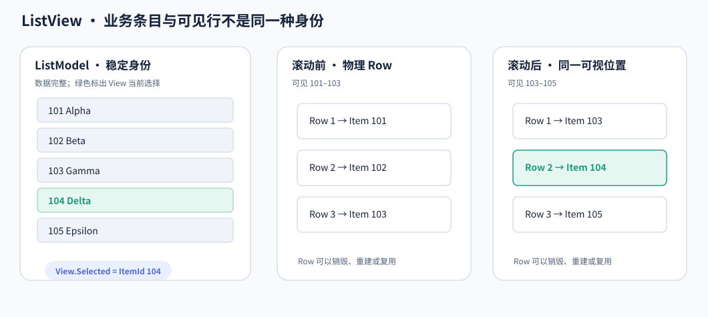

# ListView 核心设计

ListView 首先是一组业务项的视图，其次才是屏幕上的行。业务项、显示顺序和物理行具有不同的生命周期；把三者分开，才能同时支持共享数据、独立排序和虚拟化。

## 用稳定身份保存数据，而不是依赖位置

Model 持有业务值和稳定 ID。索引只表示当前容器位置，插入、删除和移动都可能改变它；稳定 ID 则让选择和更新继续指向同一个业务对象。

Renderer 读取业务值，不把屏幕行号作为业务身份。数据源抽象也允许其他模块使用自身的稳定键，因而 Tree 不需要为了显示树节点再复制一份列表数据。

## 为每个 View 建立独立的显示投影

共享数据并不意味着共享显示顺序。一个 View 可以显示全部项，另一个只显示匹配项；两者仍然引用相同的数据源。

投影保存顺序与成员范围，不持有业务值副本。选择、Active、Focus 和滚动属于各自 View；只有确实修改 Model 的操作才会改变共享数据。手动拖拽排序也是 View 对显示顺序的偏好，而不是悄悄重排其他消费者的数据。

## 只为当前可见部分建立物理行

完整投影可以很长，但当前视口只需要其中一小段。ListView 根据可见范围建立和回收行实体，把它们绑定到当前需要显示的业务键。

观察滚动前后的同一块显示区域：物理行可以继续存在，绑定的业务项却已经不同。

因此，物理行销毁不表示业务项删除，物理行保留也不表示它继续对应旧业务项。选择和业务数据以稳定身份保存，颜色与内容则随当前绑定重新投影。

## 将输入提交回逻辑状态

点击命中某个行实体后，交互先解析该行当前绑定的业务键，再修改 View 的逻辑选择或 Active。键盘与程序化操作进入相同的身份空间，不依赖目标行是否已经物化。

这也解释了为何选中离屏项是合法操作：选中的是业务对象，而不是某个屏幕实体。后续 Reveal 和滚动决定它何时进入可见范围。

数据真实删除时才清理失效身份；过滤、离屏和 Renderer 重建不应被当作删除。模型变更、投影变更与物理行更新因此可以分别发生，而不会互相冒充。
