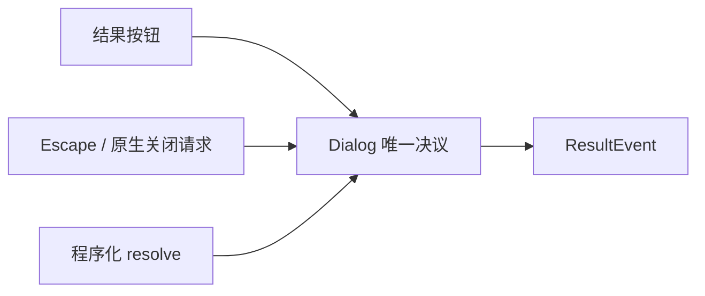
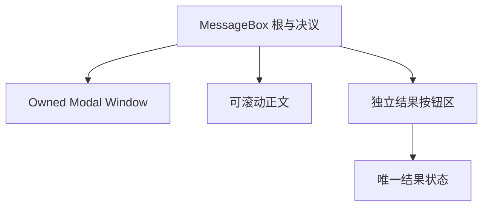
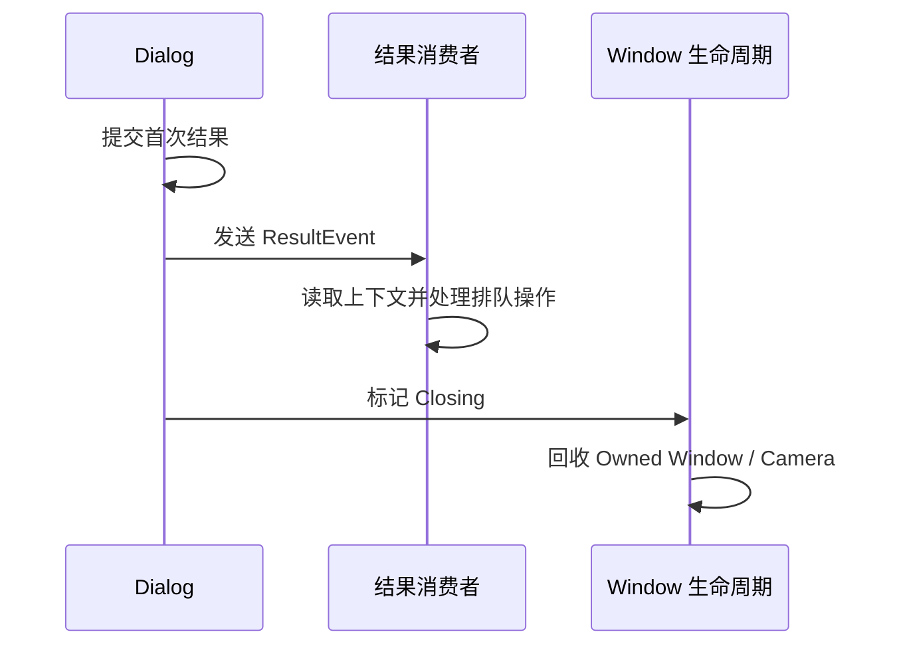

# MessageBox 核心设计

MessageBox 围绕“一次决议”组合窗口与按钮。它的职责不是阻塞线程等待返回值，而是维护一个明确结果，并在消费者有机会处理结果后结束对话框生命周期。

## 将用户选择集中到一个结果状态

多个按钮和取消入口最终都向同一 Dialog Root 提交决议。首个有效结果成为权威，后续重复请求不再改写。

这使双击、关闭与按钮激活同帧到达时仍只有一个业务结果。直接删除资源则不是用户决议，不应通过伪造 Cancel 把两条路径混在一起。

## 复用窗口和滚动，而不是重新实现它们

MessageBox 使用 Owned Window 管理原生资源，使用 Modal 关系控制父窗口输入，使用 Button 接收激活。正文放入 ScrollArea，结果区独立保留。

因此，正文变长只影响滚动，不会让确认按钮一起滚出窗口。调用方提供的内容可以自由组合，MessageBox 只拥有对话框外壳和明确的结果部件。

## 先交付结果，再回收资源

结果 Observer 可能需要读取根上的上下文，或排队打开另一个窗口。若先销毁根再通知，消费者就失去了解释结果所需的信息。

资源回收与结果提交保持顺序，但不把业务操作的成功与否归 MessageBox 管理。它负责把决定可靠交付给应用，应用负责决定之后的工作。
