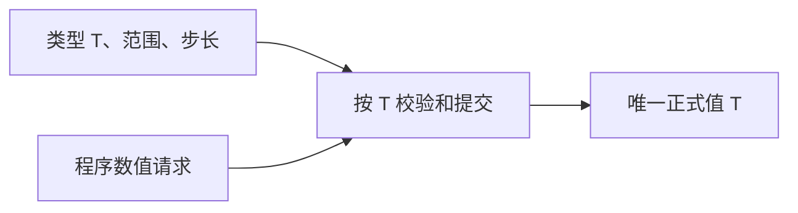
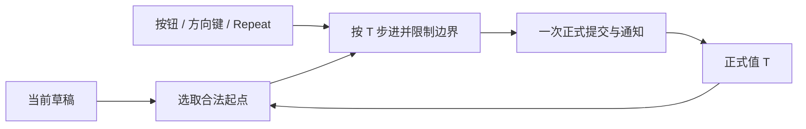

# NumberInput 核心设计

NumberInput 的中心是一份原类型正式值。文本是可暂时无效的草稿，按钮和键盘是产生候选值的输入方式，默认三段外观则把这些能力组合起来。它们共同操作同一份值，却不共享同一种生命周期。

## 先保留业务数值的原始类型

整数的精度和范围不是显示问题。把所有值转成 f64 会丢失大整数的精确性，也会让步进与错误上下文失去原始语义。因此数值状态、范围、步长和诊断快照都保留类型 T。

程序 Setter 接受范围内合法值，不要求它恰好落在步进序列上。步长定义用户增减操作，不是所有正式值的共同网格。

## 给半成品文本留出独立空间

输入负数需要先输入一个负号；如果每次键入都要求得到合法数值，正常编辑会被打断。内嵌 TextField 因此保存草稿，正式值只在明确提交时改变。

Enter 拒绝非法草稿但保留编辑内容，失焦则恢复正式值，Esc 明确放弃。合法程序赋值优先于旧草稿，同时清理待处理输入，防止下一次编辑队列把新值覆盖回去。

显示精度只改变失焦文本。1.234567 可以显示成 1.23，重新聚焦仍能恢复完整精度；若把显示字符串当成数值权威，这个过程就会不可逆地丢失数据。

## 让所有步进入口汇入一次提交

加减按钮、方向键和长按重复都沿用同一步进路径：合法草稿作为起点，否则使用正式值，按 T 安全运算，再限制到边界并一次提交。

端点不需要禁用按钮来避免越界；合法同值自然静默。Repeat 拥有计时与取消，不重新实现数值计算。失焦或禁用结束重复后，重新启用不会延续旧按住会话。

## 用明确绑定连接数值根与编辑器

NumberInput 的根是数值身份，TextField 的根是编辑行为身份，实际 Editor 保存唯一文本。公开绑定让它们可以隔着装饰层协作，而不依赖默认外框的位置。

绑定必须保持单行、无长度限制和一致只读模式，否则完整数值可能被截断或 Enter 被解释为换行。默认 Style 再组合减号、编辑区和加号；自定义 Style 可以只保留编辑区，或把触发器放到根外。

ReadOnly 保留复制但拒绝用户改变，Disabled 进一步终止当前编辑与重复，两者均不限制合法程序赋值。由此，业务数值、文本草稿、触发器和外观各自拥有清楚的边界。
