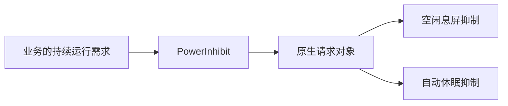
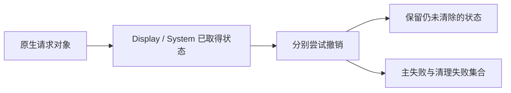

# PowerInhibit 核心设计

电源抑制是应用任务提出的进程级需求，不是某个窗口的视觉属性。模块以一个 Resource 拥有原生电源请求，业务决定何时开始与结束。

## 将业务需求变成明确拥有的原生资源

启用时创建请求对象，并申请 Display 与 System 两项能力。对象由 Resource 持有，完整启用后的重复请求复用现有状态。

窗口是否可见、是否最小化、是否存在托盘，都不能替代业务需求。模块也不为每个调用方建立隐含计数；多个需求的聚合属于应用。

## 分别记录已经取得的能力

两项原生请求可能不是同时成功。如果第二项失败，系统必须知道第一项已经取得，才能正确回滚。关闭时也需要区分哪些项已经清除、哪些仍然存在。

这种记录让重试有明确对象，而不是盲目重复所有系统调用。启用失败时尽量回滚，并以最终关闭句柄释放请求；清理失败不会覆盖最初的业务失败。

## 显式结束与最终回收分工

显式关闭返回失败，允许应用提示或重试。Resource 销毁则提供句柄级最终回收，不把 Drop 变成向上抛错的业务路径。

模块只能确认自己发起的调用与资源生命周期，不声称系统电源策略已被完全接管。
