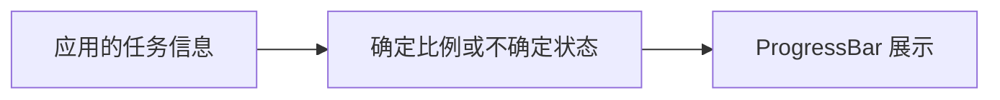
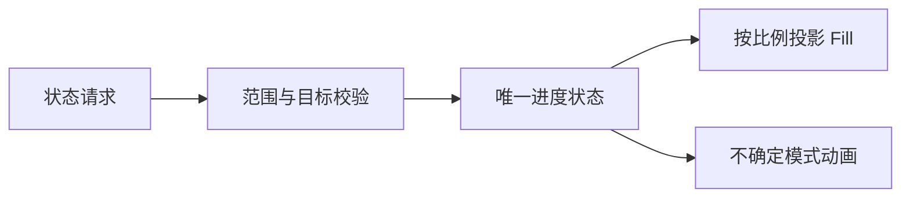

# ProgressBar 核心设计

ProgressBar 把“业务已经知道什么”投影成进度画面。它不拥有任务、采样计时或估算算法；应用提交确定比例或不确定状态，控件保存这一个展示状态，再由外观表达。

## 用模式表达信息是否充分

已知完成比例与只知道任务仍在进行，是不同的信息。设计以 Determinate 和 Indeterminate 区分，而不是把某个特殊负数解释为等待。

模式转换替换当前状态，不暗藏“进入等待前的百分比”。否则重新进入确定模式时，控件会把过时数据误当成当前事实。比例可以倒退或重置，因为这些都是应用提供的新状态，不由控件替业务判定是否合理。

## 把提交与动画分别处理

公开入口校验确定值的有限性和范围，成功后才更新持久状态。非法值保持旧状态，合法同值不制造额外变化。构造 Props 只负责初始提交，不是运行时第二份权威。

动画属于表现。一个不确定进度条持续运动，不意味着后台工作确实取得了同样幅度的进展；确定进度的颜色变化也不改写业务百分比。

## 保持只读显示的边界

默认 Style 管理轨道、填充、边框与尺寸，并从主题及局部覆盖取得颜色。没有输入状态体系，也没有在完成时自动执行应用动作。

例如业务完成了 75% 后进入一个无法估计时长的收尾阶段，应用切换到 Indeterminate；真正结束时再提交 1.0。控件只呈现每次明确提交的信息，不把动画结束、实体销毁或禁用解释为任务成功。
