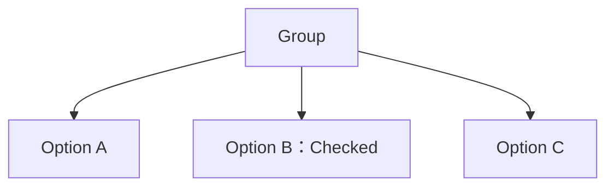
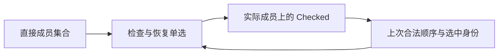
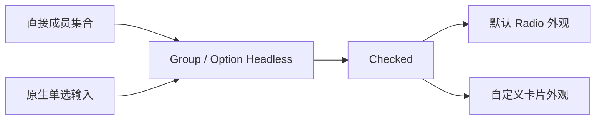

# RadioGroup 核心设计

RadioGroup 把单选理解为一个集合的结构关系：合法成员中恰好有一项 Checked。成员身份由直接父子关系决定，选中状态由 Checked 决定，结构修复只维护这种关系，不再建立第二份 selected 数据。

## 先确定成员，再解释选中

单选的前提是明确“在谁之间互斥”。Group 的直接 Option 子实体形成成员集合，Option 内部内容不参与成员计数。

Checked 是实际选择，而不是一个索引的投影。索引只在公开操作发生时解释当前成员顺序。移动或替换物理内容不会产生新的业务选择权威。

## 让集合变化保持单选成立

仅保存 Checked 无法回答“删除选中项后该选谁”。共享排他选择机制因此保留上一次合法结构的顺序和选中身份，用于恢复，而不把历史当成当前选择。

删除 B 后优先选择原来的后继 C；C 也被删除时再寻找前驱。删除未选中项、添加新项则保留已有合法选择。恢复是在维护集合结构，不是模拟用户点击，所以不会发出用户选择通知。

Disabled 限制用户动作，却不使一个成员从集合中消失。结构修复可以选择禁用项，才能避免把“不可操作”错误理解为“没有合法状态”。

## 将行为与选项画面分开

Group / Option Headless 组合原生单选输入和唯一 Checked，默认 Style 在同一实体上补充布局、Indicator 与配色。集合规则因此不依赖某种圆圈图标。

同一组内可以混合默认和自定义 Option，但它们仍共享成员边界和互斥选择。默认样式只接管默认身份，不能因为选项处于同一 Group 就覆盖自定义内容的布局与颜色。

由此，RadioGroup 的稳定关系是集合、Checked 与结构修复之间的协作；圆形标记、文字排列和具体配色只是这种关系的展示。
