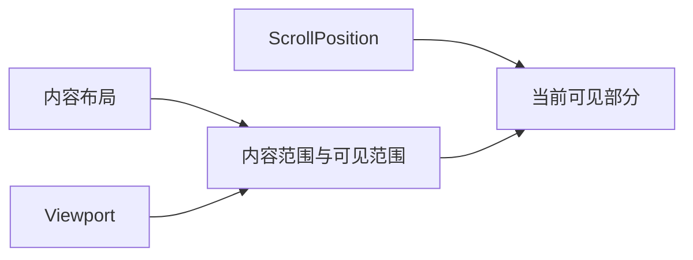
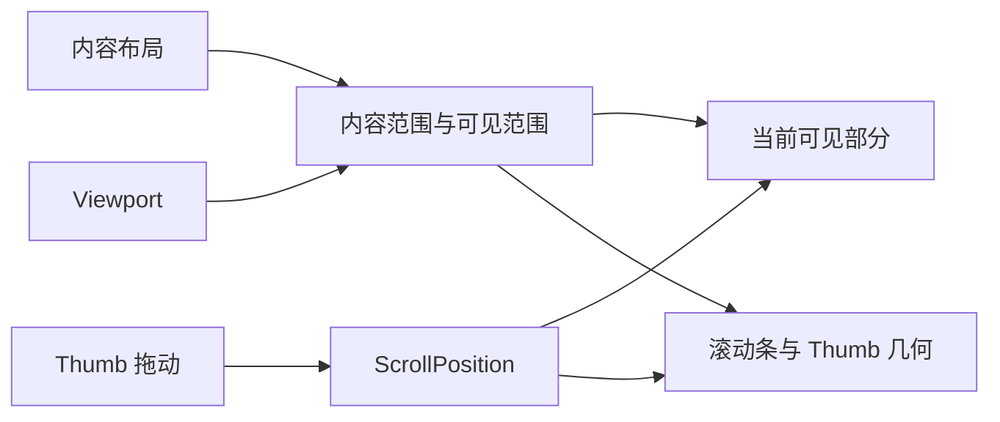

# ScrollArea 核心设计

ScrollArea 将“内容有多大”和“当前能看见多少”分开。内容保留自己的布局，视口提供裁剪范围，滚动位置决定内容中的哪一部分出现在视口内。滚动条只是这组几何关系的可操作投影。

## 先建立内容与视口的关系

没有视口，长内容只是一棵会继续增长的 UI 子树。ScrollArea 引入独立的 Viewport，让内容规模不再直接决定外部控件的可见尺寸。

`ScrollPosition` 是滚动位置的权威。垂直模式限制内容宽度，允许文本自然换行；横向与双轴模式则保留内容的固有宽度。它们改变的是布局策略，不是另建不同的滚动状态。

## 再把滚动几何变成可操作的滚动条

确定内容和视口后，滚动范围、Thumb 长度与 Thumb 位置都可以派生。用户拖动 Thumb 时，输入被换算回同一份滚动位置；不会出现“滚动条位置”和“内容偏移”各有一份独立状态的情况。

滚动条显示策略与允许滚动的轴分离。隐藏一条滚动条只移除该操作入口，不会使对应轴突然失去滚轮或程序控制能力。Auto 策略还要考虑滚动条占位对另一轴的影响，因此显示与几何依赖实际布局，而不是只在构造时判断一次。

## 让多种操作汇入同一个偏移

滚轮、键盘、Thumb 拖动和 IntoView 都在改变相同的视口位置。IntoView 沿 UI 层级寻找最近视口，避免一次局部请求同时改动多个嵌套容器。

内容缩小或视口扩大后，旧偏移可能超出范围。这是几何协调，不是业务状态重建；ScrollArea 保留内容实体，只将偏移约束到当前可达范围。

禁用也沿用这一分离：暂停用户输入，但保留偏移与几何同步。禁用的表单仍可以由应用滚动到需要显示的位置，不必先暂时恢复用户交互。原生输入对禁用的适配由共享 Disabled 机制和滚动部件共同完成，内容本身不因此销毁。
