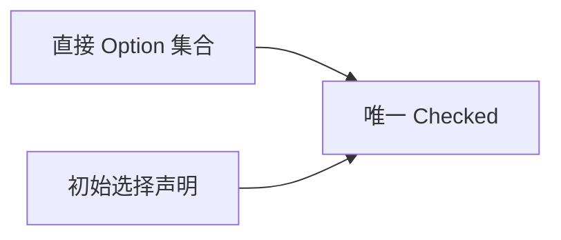
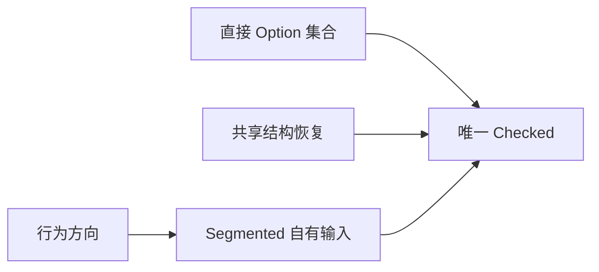
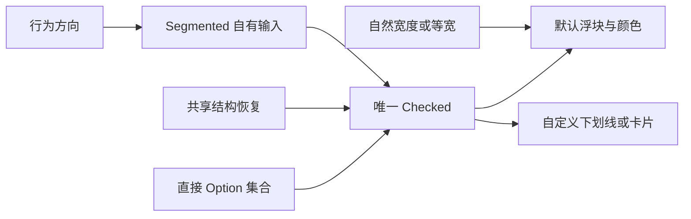

# Segmented 核心设计

Segmented 提供分段式单选，但不把它实现成 RadioGroup 的换皮。它与 RadioGroup 共享排他选择的结构恢复，同时保留自己的方向键、点击和浮块表现，以免另一种控件的输入路由改变分段语义。

## 让成员集合决定互斥范围

Group 的直接 Option 构成严格集合，Checked 是唯一选择。初始没有选择时采用首项，多个初始声明则明确冲突；这让构造结果可解释，而不是依靠实体遍历次序覆盖输入。

选项内容可以任意组合，集合身份却不由文字或浮块位置决定。删除后恢复使用共享结构历史，历史只帮助找到替补，不是长期 selected 的另一份副本。

## 在共享选择之上保留独立输入

相同的互斥结构不意味着相同的键盘行为。Segmented 的行为方向决定有效导航轴，并在 Group 焦点范围内执行不循环的移动；点击和方向键最终都提交到同一 Checked。

这种边界避免通过组合原生 RadioGroup 的完整处理器来间接获得选择，从而引入不匹配的按键消费或祖先事件传播。Disabled 约束用户动作，不把禁用成员从互斥集合中移除。

## 把选中结果投影成浮块与布局

默认 Style 读取 Checked，更新浮块位置、选项颜色和容器布局。水平等宽属于展示选择，不改变行为方向或成员身份。

因此，同一套选择可以显示成浮块、下划线或卡片，而布局改变不会产生新的选中数据。默认与外部选项混合时，共享的是选择行为，不是互相接管视觉结构。
