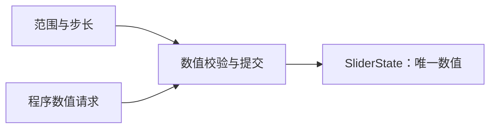
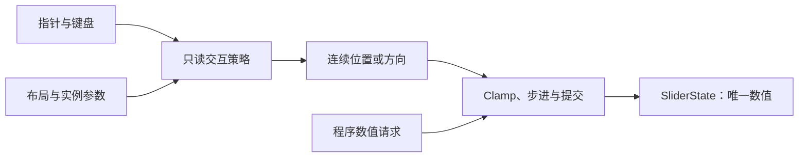
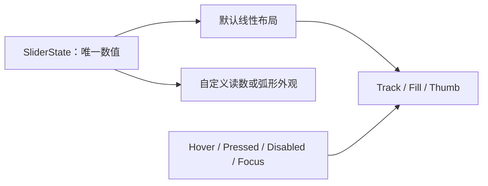

# Slider 核心设计

Slider 将“保存一个合法数值”“把输入换算成数值”“把数值画出来”分成三个问题。这样，直线滑块、弧形控制器和纯数值读数能够复用同一个范围与提交契约，而不依赖默认 Track 和 Thumb。

## 先建立与布局无关的合法数值

Headless 保存唯一 `WidgetrySliderState`，其中包括值和构造时确定的范围、步长。查询和提交只依赖这个状态，不读取布局缓存。

程序提交与用户位置投影不同：公开数值请求必须已经合法，不能靠静默吸附掩盖错误。步进范围包含从任一端点可达的值，因此从最大值反向移动与从最小值正向移动都能保留自己的步进序列。

这让数值模型在尚未创建 UI、布局尚未产生或外观完全自定义时仍然成立。

## 通过策略把输入变成候选值

坐标如何解释取决于控件形状。线性轨道、圆弧和自定义布局需要不同算法，但它们不应分别实现数值校验和状态通知。

策略只解释输入，库拥有捕获和提交。每次拖动有独立会话保存抓取偏移、方向锚点或角度连续性；Wait 保留会话而不改值，Cancel 结束会话。算法返回错误时，生命周期先清理捕获和按下状态，再传播失败。

因此外部策略可以改变几何映射，却不能绕过同一个数值权威。

## 把一次拖动与多次数值变化分开

一次手势可以零次、一次或多次改值。单纯监听 ValueChange 无法判断“按住但没移动”或“取消但数值已改变”。Slider 因此单独表达 Started 与 Ended。

Started 在轨道初次提交前发出，消费者可以先暂停外部时钟；Ended 在清理捕获后发出，提供真实终值和完成/取消结果。结束不补发同值变化，取消也不自动撤回已提交值。

播放控制条因此能保存拖动前的播放状态，而不让 Slider 代管播放时钟。手势状态属于 Slider，业务是否恢复播放属于消费者。

## 最后将数值投影为外观

默认 Style 使用公开线性绑定和真实布局，投影 Track、Fill、Thumb 与焦点环。根长度改变时，只改变像素行程，不改变数值或 Thumb 的独立尺寸。

默认 Style 只写自己拥有的视觉部件。外部组合不需要隐藏一套默认 Track 才能使用行为，这也是数值、交互策略和展示分别提供入口的原因。
