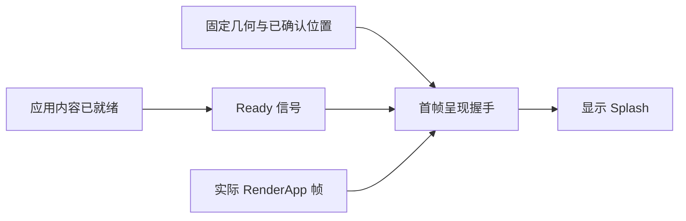
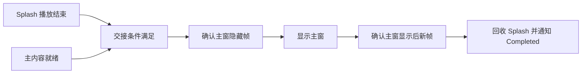

# Splash 核心设计

Splash 的问题不是“先显示一个小窗口”，而是如何在启动内容与主界面都异步准备时完成可靠交接。它把内容就绪、真实呈现和业务播放完成分成独立条件，避免用一个布尔值代替整个启动过程。

## 让应用内容与窗口呈现各自负责

应用创建 Camera、图片和 UI，并声明内容已经可以绘制。Splash 管理窗口几何及显示时机，但不根据是否存在某张图片判断内容完成。

固定物理尺寸让启动画面不受普通窗口缩放策略重新解释。显式排除标记把这份几何所有权交给 Splash，而不是让两个插件同时调整尺寸。

## 用帧身份防止旧渲染结果提前解锁

一次呈现检查对应具体 Window、尺寸和比例快照。窗口几何变化或会话销毁会使旧 Ticket 失效，迟到的 Render 结果不能显示新尺寸下尚未就绪的画面。

Ready 因此只是握手的一端。内容就绪、窗口已定位、对应帧真实完成，三者满足后才提交 Visible 并通知应用。全隐藏期间仅为在途握手唤醒反应式循环，完成后不永久维持刷新。

## 将主界面交接拆成两个方向的等待

播放结束不代表主业务完成，主业务完成也不代表启动动画应该立即结束。Finished 与 Main Ready 独立保存，任意顺序到达都不会丢失另一条件。

显示主窗口后仍保留 Splash，直到主窗口的真实可见性与新帧再次确认，避免交接中露出空白或后景。主窗口初始隐藏由宿主在创建前设置，库不能事后消除已经发生的闪现。

## 把取消与完成交接分开

Cancel 撤销 Ticket 并结束 Splash，不替应用决定主窗口下一步。Completed 则表示交接完成，两条路径的业务意义不同。

Camera 与内容始终由应用拥有，Splash 只清理自己持有的窗口和会话。失败时保留实际已经发生的状态，不虚构“所有原生 Show 操作都没有发生”。应用据此决定保留、取消或退出。
