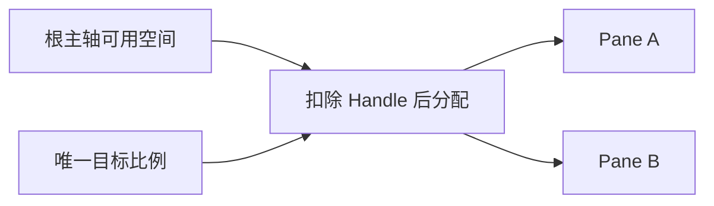
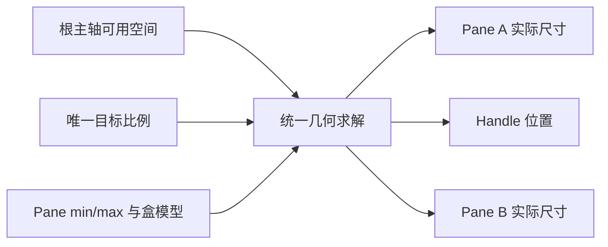

# Splitter 核心设计

Splitter 保存的是两个面板之间的目标比例，而不是一对固定像素宽度。原生布局约束决定当前真正能分配多少空间，用户偏好与实际几何因此可以在窗口缩放时分别保持。

## 从一份比例得到两个区域

固定结构由 Pane A、Handle、Pane B 组成。扣除 Handle 占用后，比例描述 A 的份额，B 使用剩余空间；不独立保存两个互相可能矛盾的面板比例。

横向与纵向只是主轴选择。Pane 里的内容、滚动和交叉轴布局留给应用，分隔器只处理自己负责的分配。

## 把原生约束纳入同一次求解

面板可能有 min/max、百分比、padding 和不同盒模型。只用根宽度乘比例会忽略这些限制，最终导致 Handle、面板和父级各自维护一套不一致的几何。

约束使用当前空间解释，百分比不会被缓存成初始像素。根范围与内部面板可经布局阶段继续收敛，但它们共享相同的几何关系。

## 区分用户改比例与环境挤压

拖动和程序操作表达新的比例意图；窗口变窄或约束改变则属于环境变化。后者可以暂时把实际几何推离目标，但不替用户保存一个新偏好。

例如目标为 30%，左面板最小宽度 180。窗口变窄后左侧可能暂时占 45%；重新放大时仍尝试 30%，而不是把 45% 当作用户刚刚拖出的结果。

这一关系也决定了通知：初始化和被动布局变化不是用户修改比例，不能用每一次几何收敛制造业务变化。

## 让拖动只拥有本次分隔操作

Handle 的拖动读取实际布局，把输入映射为可提交比例。取消、失焦、禁用或结构失效结束当前会话，不把旧捕获转交给另一个面板。

resizable 只是是否开放拖动入口；它不替代 Disabled，也不禁用 Pane 里的按钮和编辑器。默认 Style 只管理 Handle 与分隔线，业务面板不因比例更新而重建。
