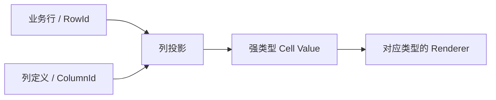
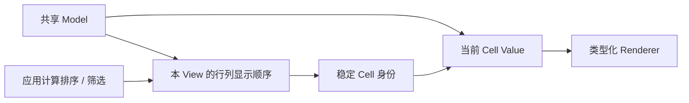
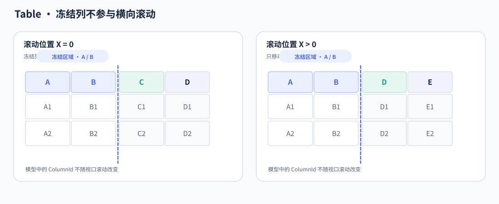
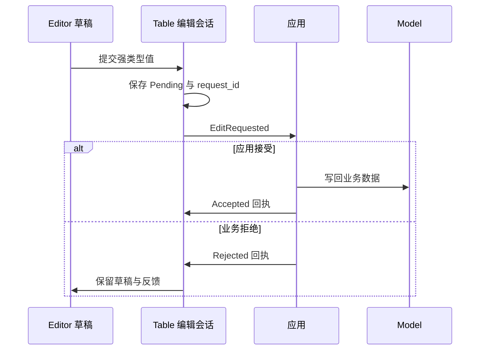

# Table 核心设计

Table 的核心是把业务数据、视图投影和屏幕单元格分开。业务行列可以长期存在，某个 View 可以独立排序筛选，实际 Cell Entity 则只为当前可见区域服务。编辑又在这三者之上建立带身份的提交会话，而不让显示层直接改写业务 Model。

## 从稳定行列身份得到单元格

Model 保存业务行和列定义。列通过类型化投影从一行业务数据取得 Cell Value，Renderer 按值类型构造内容；列标题采用独立的 Header Value 与 Renderer。

Cell 身份是稳定 RowId 与 ColumnId 的组合，屏幕位置不是身份。移动行列只改变顺序，不能把 A 单元格的选择、列宽或编辑草稿移交给恰好出现在原位置的 B。

## 将显示次序交给各自 View

共享 Model 不意味着所有表格都按同一顺序显示。每个 View 保存行投影、列顺序、Layout、Selection、Focus 和 Scroll，业务值仍从共享 Model 按稳定 ID 读取。

应用决定业务比较与过滤，Table 接收完整合法的 RowId 序列。排序标记和过滤标记是已提交投影的说明，不是内部悄悄运行的业务算法。受控 View 等待新结果时保留当前子集，避免未经应用判断的新行自动进入列表。

## 把同一逻辑表格投影到可见分区

二维虚拟化只物化当前可见行列。冻结列进一步把屏幕划分为固定区和水平滚动区，但它们仍共享一份逻辑行序列。

冻结区取 View 当前显示顺序的前 N 列。主 Body 的 `ScrollPosition` 是滚动权威，冻结 Body 与行标题投影其纵向偏移，列标题同步对应区域的横向位置。

这不是两张需要同步选择的表格。跨冻结边界的选区仍由稳定 Cell 身份表达，只在命中与绘制时分别换算坐标。N 不因可用宽度不足而缩小；超宽冻结部分被裁剪，但逻辑上仍属于冻结区。

列拖拽改变显示顺序后，Cell 和 Header 依据同一顺序迁移到正确分区，列宽继续属于 ColumnId。物理 Shell 的创建和回收不会重定义业务身份。

## 在显示之外建立编辑会话

Renderer 只读显示，Editor 则产生待提交的强类型值。编辑会话保存目标 Cell、编辑实体和请求身份，避免把临时草稿写进正式 Model。

应用拥有业务接受权，Table 拥有会话与显示权。Pending 阻止重复请求，但不是应用事务的替代品；过期回执不能完成另一个 Cell 的新会话。

虚拟化不能随意销毁正在编辑的草稿，因此编辑期间保留必要的额外 Shell。相反，目标 Cell 真实删除或 Source 实例更换意味着身份失效，此时必须结束旧会话，而不是把草稿套到新对象上。

## 让选择、复制与显示使用相同的投影

连续选择以当前 View 的行列顺序解释范围。复制冻结这次操作的逻辑 ID 序列，从 Model 读取全部选中值，而不是从可见 Text 拼接内容。

因此，选区即使跨过视口边界，复制仍然完整；过滤掉的业务行不会混入；列重排后 TSV 顺序与用户看到的顺序一致。Copy Formatter 与 Renderer 分离，使视觉装饰不污染数据文本。

Table 的一致性由这一条关系维持：业务身份贯穿读取、投影、选择、编辑和复制，屏幕分区与物理实体只是该身份在当前 View 下的不同呈现。
