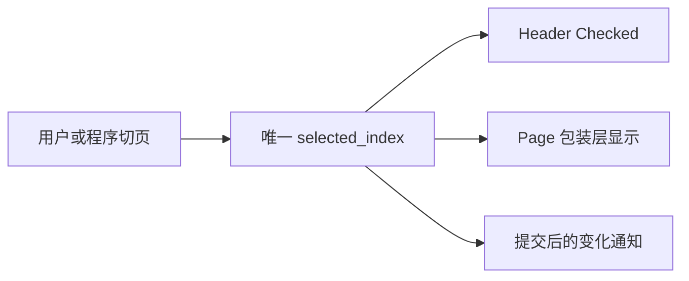
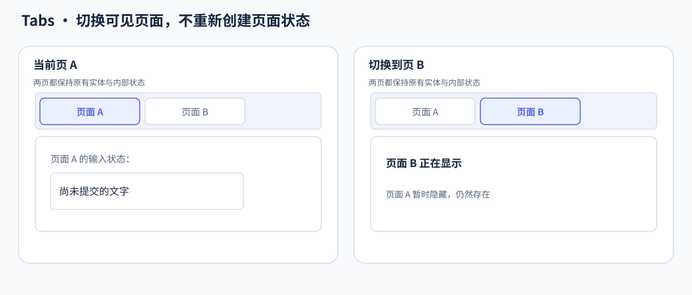

# Tabs 核心设计

Tabs 将固定的标题—页面配对与当前选择分开。一次选择只决定哪一页可见，不决定其他页是否存在；因此页面内部的编辑、滚动和业务状态能够跨切换保留。

## 先固定标题与页面的对应关系

每个 Tab 在构造时同时声明 Header 和 Content。初始化将它们分别组织到标签栏和页面容器，但保留稳定配对。

配对固定后，公开索引有明确含义。运行时任意增删或重排会同时影响选择、标题和页面身份，因此当前集合不把动态结构变化混入切页操作。

## 用唯一选择投影两端

运行时选择是一份索引状态。Header 的 Checked 与 Page 包装层的显示都从它派生，不分别接受独立控制。

这让标题强调与正文可见性同时描述同一个选择。若直接改某页 Display，就会出现“标题选 A，正文显示 B”的平行状态，所以展示组件不是选择的权威入口。

## 隐藏页面而不是销毁页面

A 页中的输入草稿在切到 B 后仍存在，返回 A 不需要重新初始化。隐藏影响渲染和输入资格，不自动暂停业务 System；这正是 UI 生命周期与业务运行生命周期的区别。

Tabs 只修改页面包装层，不覆盖应用在页面内部设定的布局和视觉状态。页面滚动也由内容自行组合，不被标签栏的滚动机制接管。

## 让标签栏处理空间，而不改变选择身份

标签数量固定不代表始终能装进视口。标签栏通过 ScrollArea 承载溢出，选中定位复用 ScrollIntoView。滚动只改变标题的可见位置，不改变索引或配对。

横向与竖向改变布局和方向导航，默认 Style 管理标题与外壳；业务页面不因主题刷新被重建。由此，固定结构、唯一选择、常驻页面和独立滚动共同组成 Tabs 的行为边界。
