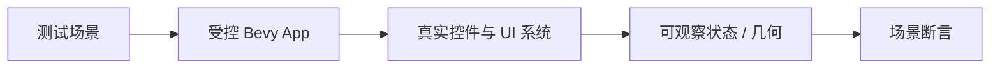
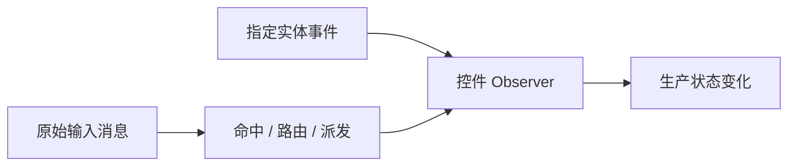

# Test Utils 核心设计

控件正确性不仅取决于一个函数返回什么，还取决于 ECS 提交、输入路由和 UI 阶段如何协作。Test Utils 提供真实系统组成的可控环境，而不是用一套模拟控件实现代替生产逻辑。

## 由测试控制运行条件

测试创建 App，显式安装所需能力，准备实体和资源，再决定何时执行 Commands 或推进下一帧。不同环境辅助函数提供不同层次的基础设施，不把所有测试都强制放进完整窗口运行时。

这使测试可以区分同步提交、延迟命令和布局传播，而不是依赖不明确的等待时间。

## 输入辅助区分语义与路由

直接触发某个实体上的 Pointer 事件，可以检查 Observer 的语义。把 PointerInput 交给 Picking 管线，则可以检查命中、传播与捕获。两种入口服务不同问题，不互相冒充。

键盘测试同样保留真实 Focus 和输入目标关系。根实体与 Editor 分离时，测试必须经过实际绑定才能覆盖相应行为。

## 观测不改变被测系统的责任

错误和日志捕获只保留原始事实，不把失败自动标记为已处理，也不替业务执行修复。这样测试能同时检查状态、诊断身份和报告次数，而不改变生产传播路径。

共享辅助代码仅进入测试与 Benchmark 依赖。它减少环境搭建的重复，但每个测试的输入、预期结果和验证范围仍由具体场景决定。
