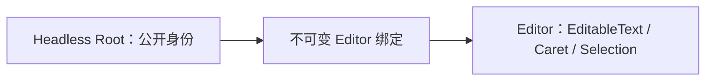
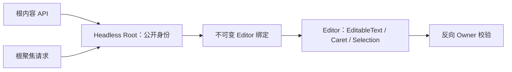
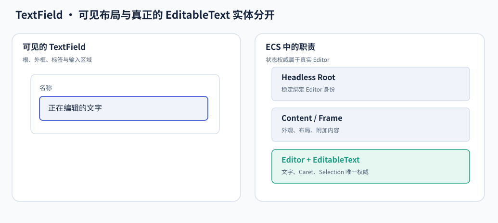
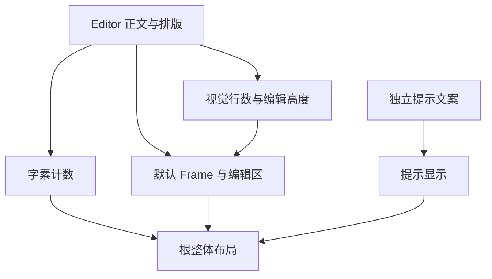

# TextField 核心设计

TextField 将“对外代表一个输入框的根”与“真正保存编辑状态的实体”分开。根负责组合、配置与公开身份，Editor 负责唯一正文、光标和选择。这样，输入框可以增加前缀、后缀、计数或装饰，而不重建编辑状态。

## 让正文只存在于真实 Editor

Bevy 的 EditableText 已经拥有正文、Caret 和 Selection。TextField 不在根或 Props 里保存另一份文本；构造参数只初始化 Editor，公开内容入口也最终操作这个 Editor。

根与 Editor 通过双向归属和祖先链验证，而不是依赖“第几个子节点”。因此两者之间可以插入任意装饰容器，默认 Frame 也不是编辑行为成立的条件。

## 将聚焦和内容操作路由到同一位置

有了独立根，外部请求仍需要找到真正的输入目标。绑定同时支持内容读写、程序化聚焦和窗口初始焦点，避免某个复合控件把焦点留在只有边框的 Root。

图中的 Frame、Prefix、Suffix 可以改变布局，但真正正文仍只有 Editor 一份。槽内按钮有自己的焦点，不会因为处于输入框内部就成为正文的一部分。

## 在编辑入口统一限制文本变化

长度限制按完整字素簇处理，避免把一个可见字符截断。ReadOnly 只拒绝修改，保留选择和复制；Disabled 进一步阻断用户编辑，并清理已排队但尚未应用的输入。

限制作用于实际编辑路径，而不是只把颜色改灰。因此重新启用后，旧 Paste 或 Edit 不会突然写入。合法程序内容替换仍可进行，并与旧输入队列建立明确顺序。

根上的字体、布局和过滤配置可投影给 Editor；没有明确根配置时，Editor 自身设置保留。主题切换只改变展示，不重置正文和选择。

## 从编辑状态派生辅助展示

计数读取唯一正式正文；提示拥有独立文案；AutoSize 读取实际排版后的视觉行数。三者的来源不同，不能统一归为一份“输入框文本”。

例如提示换成三行，只增加根的提示高度，不应把编辑器误算成多输入了三行。前后槽位文字也不进入正文计数。默认 Style 将这些部件组成完整输入框，自定义 Style 则只采用需要的能力，仍共享同一个编辑器权威。
