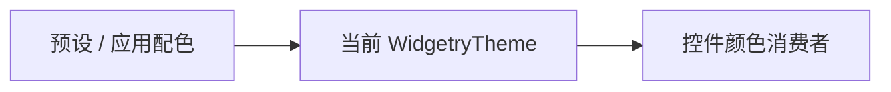
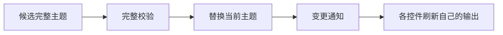

# Theme 核心设计

主题切换要让所有控件读到同一套颜色，却不应让主题模块知道每个控件的内部实体结构。Theme 因此保存完整配色，控件自己把配色转换为视觉输出。

## 用一份完整数据表达当前主题

`WidgetryTheme` 是 App 中的当前颜色权威。它按控件和语义状态组织颜色，不把“深色”“浅色”名称当作运行时状态，也不把布局与动画混进配色。

应用可以从预设复制并修改，最终仍提交相同结构。可选预设只影响哪些数据入口进入编译，不影响消费者理解主题的方式。

## 整体提交后再通知消费者

主题包含许多相关字段。如果边校验边修改，部分控件可能读到新颜色，其他控件仍停留在旧配置。Setter 因此先验证完整候选，再一次替换 Resource 并发出变更通知。

同值不构成变化。通知只说明主题已提交，不把所有控件的布局和视觉刷新合并成一个全局事务。

## 局部外观继续由控件拥有

控件结合当前交互状态、主题和局部覆盖得到最终颜色。Theme 不遍历控件子树，也不直接替它们写背景、边框或文字。

例如应用只覆盖 Button 的正常背景，切换主题后这个背景保持，而未覆盖的悬停色和边框仍来自新主题。覆盖是对具体字段的选择，不是为该按钮复制出第二套全局主题。

组合控件的调色板归属与前景传播是消费者之间的协作，见 [外观机制](../mechanisms/appearance.md)。Theme 本身保持为单一颜色数据与变化入口。
