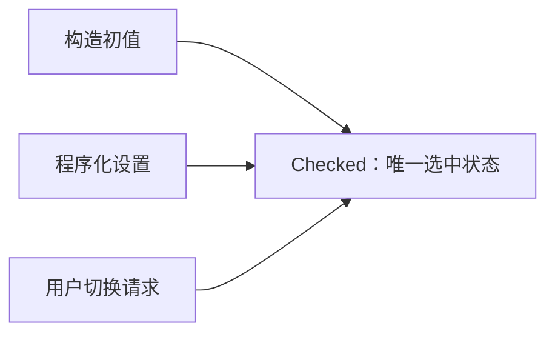
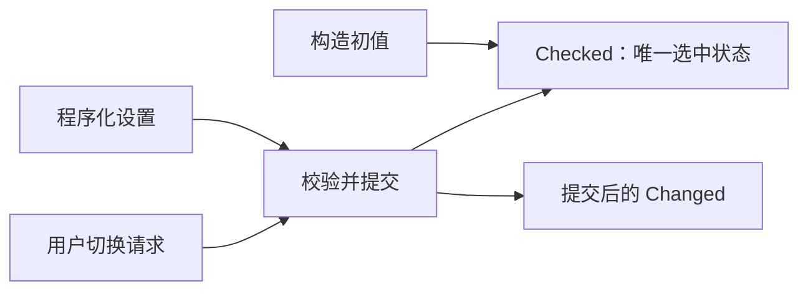
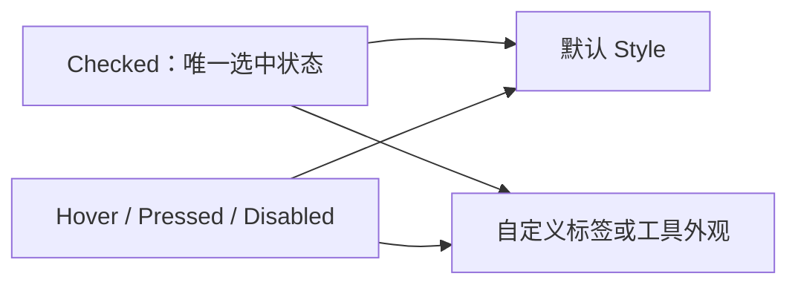

# ToggleButton 核心设计

ToggleButton 把瞬时输入转换为持续的二态选择。设计的中心不是按下效果，而是让用户输入、程序化设置和视觉反馈始终围绕同一份选中状态。

## 先确定唯一的二态状态

ToggleButton 复用 Bevy 官方 `Checked`，不在 Props、内部模型和视觉组件中分别保存一份 selected。构造参数只初始化这份状态，后续查询都面向当前实体。

这样，业务关闭一个工具后，显示不会被某个旧 Props 或颜色缓存重新打开。Checked 的存在与否表达业务状态，Pressed 只表达短暂输入，二者不混用。

## 让通知跟随真实提交

输入请求和状态变化不是同一个时刻。Headless 接收请求，通过同一路径提交 Checked，再通知已经发生的实际变化；合法同值操作不形成第二次变化。

专用变化事件让消费者读取到已提交状态，而不是把官方输入请求误当成结果。直接操作原生 Checked 仍保留 ECS 语义，但不会被追认为一次通过控件 API 发起的变化。

禁用限制用户输入，不抹掉 Checked，也不阻止合法程序化设置。因此“选中且禁用”是一个完整状态，而不是非法组合。

## 在状态之上生成按钮外观

默认 ToggleButton 同根组合 Headless 和 Style。Style 将 Checked 与交互状态组合为选中/未选中的四态配色，并管理自己的前景输出。

默认方框、图标或布局不是行为成立的条件。一个矩形工具按钮与一个圆形开关可以表达同一份 Checked；更换视觉结构不会产生另一套选择状态或另一条提交流程。
