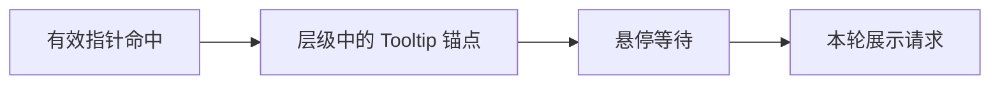
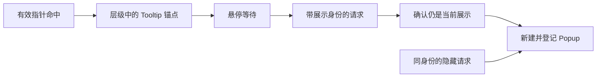

# Tooltip 核心设计

Tooltip 把“当前应该解释哪个目标”和“解释内容怎样展示”分开。前者是一段由输入驱动、带有身份的展示生命周期；后者是这一生命周期中的临时 UI。

## 从命中对象确定一个锚点

指针可能命中控件的文字、图标或更深层内容，但提示通常属于整个控件。Tooltip 沿命中层级解析锚点，把多个内部命中归并到同一个解释目标。

相同锚点持续 Hover 不重复创建内容。Cold / Warm 计时区分首次停留和连续浏览，使短暂经过不会立刻产生提示，而已经进入阅读状态的用户可以更快查看相邻说明。

一个 App 只有一个活动展示，锚点和窗口共同确定其输入归属。失效输入不会继续维持一个脱离实际指针的提示。

## 给每一次展示独立身份

展示请求与 UI 构造之间可能存在 Commands 延迟。用户已经移向新目标时，旧请求仍可能等待执行，因此只保存 Anchor 不足以辨别请求是否有效。

Show 与 Hide 携带同一轮展示身份。较早的 Hide 不能销毁较新的 Popup，过期的 Show 也不能覆盖当前展示。生命周期协调器登记真正拥有的 Popup，而不是假定提示必须是 Anchor 的直接子实体。

例如，指针从 A 很快移到 B，A 的延迟构造此时才执行。身份检查使 A 的请求失效；B 已经显示的提示不受影响。这里解决的是过时操作的归属，而不是仅在界面上避免重叠。

## 将外观作为展示请求的消费者

默认 Style 消费请求，使用 Factory 创建临时内容并根据窗口空间定位。外部 Style 可以消费相同请求构建不同外观，但仍使用同一登记和清理机制，无需复制悬停状态机。

Popup 不参与 Picking，因而不会成为遮住原锚点的新输入目标。配色刷新只改变现有输出，不重建内容。Hide 释放本轮展示实体，业务状态则仍留在锚点或应用中。

这种分工使提示的生命周期、输入归属和外观变化相互清楚：换一种显示方式，不会改变“何时出现、属于谁、何时失效”。
