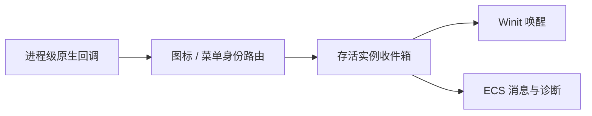

# Tray 核心设计

托盘是独立于窗口的原生对象。它把桌面操作转换成应用可消费的意图，但不拥有恢复窗口、退出确认或常驻策略。

## 图标生命周期不依赖窗口

主线程持有托盘对象。窗口隐藏不会销毁图标，图标点击也不会直接寻找一个窗口并修改它；两者只在宿主业务中建立关系。

这使同一能力既可用于单窗口应用，也可用于多窗口或全隐藏状态，而不内置某一种窗口模型。

## 用实例路由隔离全局回调

原生库提供进程级事件入口，但应用内部需要区分真正拥有事件的实例。桥接层因此按图标和菜单原生身份路由，只保留指向存活桥接对象的弱引用。

回调只排队并请求唤醒，不捕获 World 或应用。实例销毁先撤销路由，再回收原生对象和通道；迟到回调不会继续写入旧应用。

## 菜单描述与业务结果分离

宿主保存菜单描述，库将其投影为原生菜单。激活时返回宿主定义的项目 ID，而不是把原生 MenuId 暴露为业务身份。

勾选项的外观不是业务真值。应用根据收到的意图更新业务状态，再提交新的菜单描述。禁用和层级关系也在当前描述下校验，旧原生菜单的迟到事件不能绕过当前资格。

原生菜单交互可能进入自己的消息循环，关闭手势因此由原生适配层协调；这个细节不扩展为库对应用窗口生命周期的接管。
