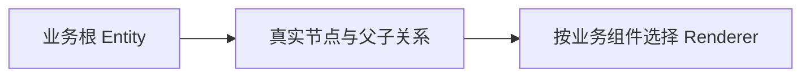
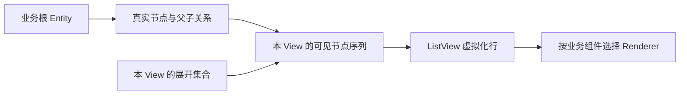
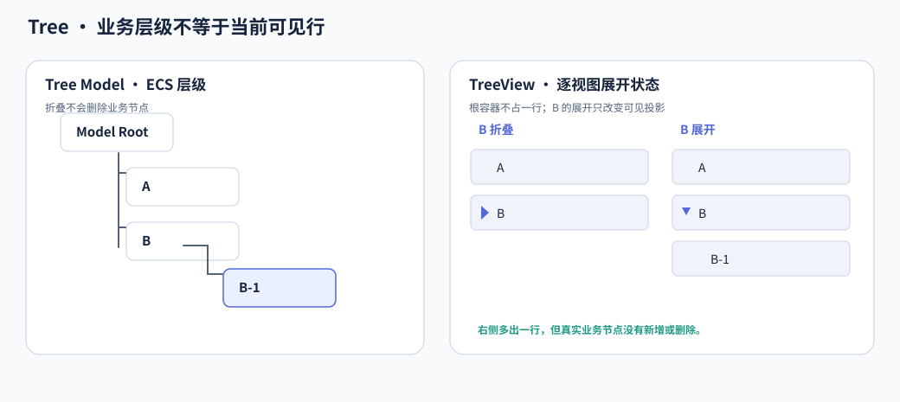

# Tree 核心设计

Tree 把业务层级与树形显示分开。业务节点本身就是 ECS Entity；TreeView 根据自己的展开状态，把这棵树投影成一条可虚拟化的可见序列。显示行可以消失，节点身份不能因此消失。

## 直接使用业务层级作为数据

`WidgetryTreeModel` 保存业务根，节点通过 `WidgetryTreeNode` 和真实父子关系组成树。异构业务内容由节点上的 Component 表达，Renderer 负责把对应内容显示出来。

这种结构避免再维护一份与 ECS 层级同步的字符串树。节点移动或删除直接作用于业务结构，显示层只读取它。

## 让每个 View 产生自己的可见序列

一棵树可以被多个 View 观察，但“展开哪些节点”是查看方式，不属于共享数据。每个 View 保存独立展开状态，并据此遍历业务层级，生成带深度信息的可见节点序列。

Tree 以业务 Entity 作为列表键，直接接入 ListView 数据源与投影，不另外分配一套 ListItemId。选择也由内部列表的 `WidgetryListSelectionState<Entity>` 保存，不在 TreeState 中重复存储。

下面的对照保持业务树不变，只改变 View 的展开情况。

折叠后，某个后代不再出现于可见行，但仍是合法业务节点。滚动回收又发生在更后面的物理显示层，两种“看不见”都不等于删除数据。

## 用加载状态区分空节点与未知子树

没有子实体可能表示真实空目录，也可能表示尚未取得数据。Tree 通过 Unknown、Loading、Loaded 区分这两种语义，而不是从 Children 是否为空推断加载状态。

展开未知节点产生加载意图，应用负责实际工作。加载完成后建立真实子节点，再通知状态完成；不同 View 随后可以用自己的展开状态展示新数据。View 的展开生命周期与数据加载生命周期并不相同，因此折叠不等于删除已加载数据。

## 将拖放变成受校验的结构修改

普通列表重排可以只改变 View 顺序，Tree 的移动却改变业务父子关系。拖放预览先判断落点是否允许，正式提交再验证成员、父链、循环、禁用及目标加载状态。

成功提交后，源节点身份保留，只改变父级或兄弟位置；所有 View 从同一棵业务树重新生成投影。失败则不改写局部层级，也不把尚未完成的加载当作可用容器。

这样，Tree 的状态分工保持一致：业务层级决定节点在哪里，展开集合决定本 View 看见哪些节点，列表选择决定用户选中了谁，物理行只负责当前呈现。
