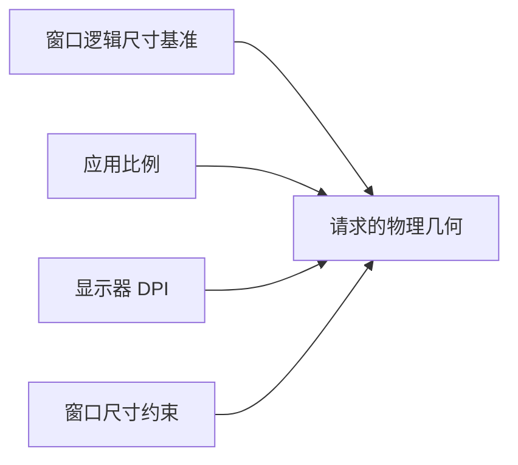

# Ui Scale 核心设计

Ui Scale 将应用比例与窗口尺寸基准分开。全局比例表达用户希望界面放大多少，每个窗口保存自己的逻辑尺寸；两者共同决定请求的物理几何。

## 不把物理尺寸当作永久设计尺寸

窗口物理尺寸同时受应用缩放、系统 DPI、用户 Resize 和约束影响。如果每次都在上一次物理尺寸上乘比例，就会累计误差或重复缩放。

管理器保存逻辑基准和上次请求尺寸，用来区分自身投影与用户调整。用户 Resize 更新基准；受约束暂时无法达到目标，不意味着应丢弃原设计尺寸。

## 在统一阶段同步全部受管窗口

资源 `WidgetryUiScale` 是应用配置权威，各窗口的真实几何在 Sync 阶段收敛。更新排在相机处理前，并把必要的窗口变化交给后续渲染消费者。

这样，多个窗口按同一配置更新，但不会共享一个错误的尺寸基准。比例同值或静态窗口不需要反复写入相同输出。

## 用显式排除保持特殊窗口独立

某些窗口以固定物理尺寸工作，不能套用普通窗口的逻辑尺寸策略。`WindowScaleExcluded` 明确让出这些窗口的管理权，而不是让 Ui Scale 依赖具体 Splash 或其他业务类型。

排除期间保留现状；重新接管从当前窗口建立基准。标记表达的是谁拥有几何管理权，不是一次临时乘法开关。销毁后的新窗口同样从新实例状态开始，不复用旧缓存。
