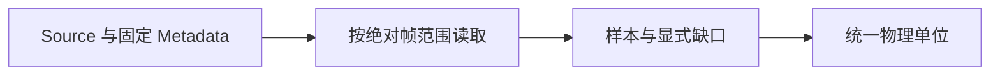
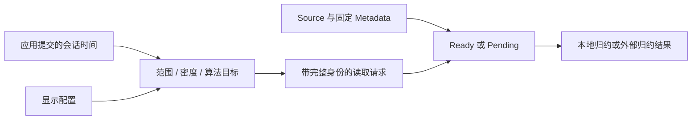
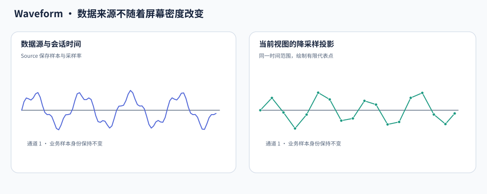
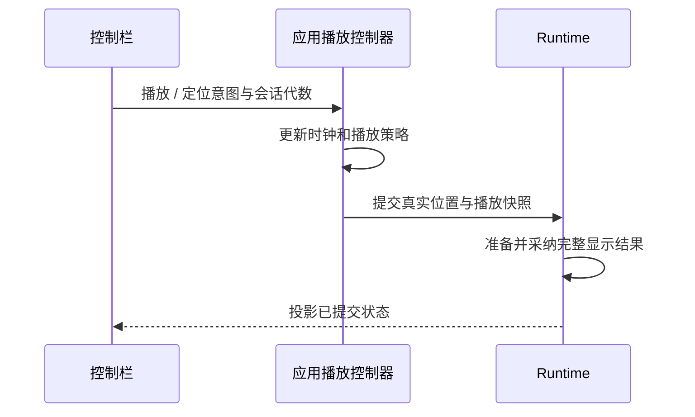

# Waveform 核心设计

Waveform 将“数据是什么”“想看哪个时间范围”和“屏幕上已经显示了什么”分开。应用提供数据源与会话时间，Runtime 读取并归约目标范围，Renderer 只消费完整提交的显示快照。

## 从固定会话元信息解释数据

Source 不只是返回数值数组，还定义通道、采样率、单位和 Live / Replay 类型。这些信息在一个会话中固定，决定每个帧索引的时间和每个数值的物理含义。

缺口是有效性数据，不从 NaN、零值或代表点距离推断。Source 必须给出完整请求长度，Runtime 在提交前将有效样本换算成 V。这样相同物理信号不会因为来源使用 µV 或 mV 而具有不同显示高度。

## 由外部时间形成读取目标

应用拥有采集或回放时钟。Runtime 根据累计时间、显示跨度、像素密度和算法构建请求，reader 与 session identity 隔离共享 Source 的不同消费者。

Pending 表示当前目标还没有结果，不是错误，也不能用另一请求的数据填补。换源、定位、切算法或改变跨度都会使旧目标失效；旧结果即使计算完成，也不自动成为当前画面。

## 将波形与时间范围作为同一快照提交

目标可以先变化，显示不能只变化一半。新数据尚未就绪时，Runtime 保留旧波形及与它匹配的旧时间范围；结果完整且身份仍有效后，再一起替换。

例如，从 1 秒跨度切换到 5 秒时，不能立即拉长时间轴却继续显示旧 1 秒数据。旧画面暂留，比“新轴配旧波形”的错误解释更重要。

大规模归约可以交给 JobManager，但任务终态与业务采纳仍是两回事。Runtime 等待真实 Finished 取得归约状态，再检查目标身份；取消的旧工作需要真实退出，不能立即复用仍由工作线程持有的状态。

## 用不同算法表达不同观察目的

MinMax 保留桶中的极值与连续有效段，适合观察尖峰；LTTB 保留真实样本代表点，描述折线形状。它们不是相同数据的两种颜色，也不是可以互相推导的缓存。

下面用原始采样和有限显示点的对照说明归约的目的：显示数据可以更少，但必须保留其对应的时间和缺口含义。

两种算法都保留缺口边界。MinMax 不跨缺口合并包络，LTTB 不跨缺口求均值或连接。外部预归约 Source 也必须提交相同语义，而不是只提供一串看似接近的点。

## 把数据更新与屏幕布局分开

已提交数据与归约结果不依赖通道行高。幅值、每屏通道数和滚动只改变布局投影，因此垂直滚动不重新读源，暂停时改幅值也能立即更新显示。

标签与波形共享已应用的垂直偏移；离屏纹理按可见绘图区分配，不按所有通道的总高度分配。测量矩形和控制栏属于 UI 覆盖层，不进入数据缓存或 Reducer。

## 由宿主控制 Replay 的真实播放状态

控制栏发出播放、倍率与定位意图，应用接受后才提交播放快照。Widget 不通过按钮图标猜测时钟状态，也不在本地偷偷推进时间。

定位预览只是更低输出密度的目标状态。结束预览后请求最终密度，时钟暂停与恢复由应用决定。这使播放、读取、渲染三个速度不同的过程仍共享明确的时间语义。
