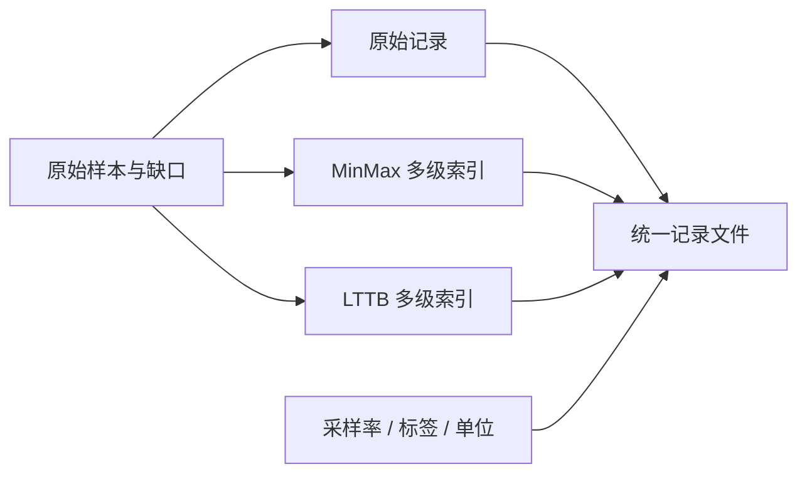
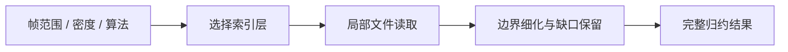
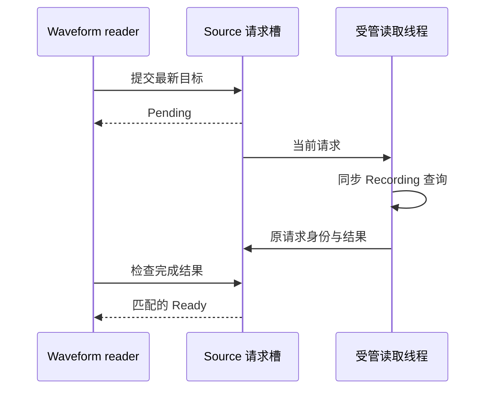

# Waveform File 核心设计

Waveform File 负责把“一个很大的离线记录”转换为 Waveform 可以按当前视口读取的数据源。文件存储与 UI 分离，索引与原始记录绑定，后台请求与消费者身份绑定。

## 将数据、有效性与索引放在同一记录中

只存样本而把索引放在任意 sidecar 中，容易出现索引与记录错配。Recording 将原始数值、逐通道有效性、元信息和两套算法索引放在同一个文件中，打开时验证布局关系。

MinMax 层合并极值与连续有效段；LTTB 各层从原始样本独立生成代表点。它们具有不同语义，不能为了共享索引就把 LTTB 建在极值包络上。

构建先写临时文件，全部完成后发布，已有目标拒绝覆盖。打开后的记录保持不可变，使索引中的偏移与业务内容始终对应。

## 让查询成本跟随观察范围

查询由帧范围、输出密度和算法共同决定。Recording 选择适当索引层，读取相交部分，并对边界细化，避免把请求外的极值带入结果。

有效段与端点仍是结果的一部分，输出数量不简单等于像素数。长范围或密集缺口可能增加工作量，但无需把整份记录常驻内存。

## 用长期服务线程隔离同步 I/O

Recording 是同步查询接口。DiskWaveformSource 在它外面建立长期受管线程，让 UI 只提交请求与提取完成结果。

每个 reader 保存最新目标，完整请求身份区分会话、代数、范围、算法和密度。旧结果或旧错误不能覆盖新目标；共享 Source 的不同 View 互不夺取队列。

## 让关闭等待真实退出，而不是阻塞界面

删除 Source 或取消任务时，只发停止信号并唤醒服务。正在进行的同步读取不能被假装已经中断；服务完成当前操作、清理请求并实际退出后，Job 才进入终态。

终态收尾拥有者继续消费迟到结果和失败，避免 UI 已销毁后无人承接诊断。应用可以通过 Job 身份观察服务，但不能把“请求取消”当作“线程已经回收”。

这一边界让文件读取保持普通同步代码，同时向 Widget 提供真正非阻塞、可隔离过期结果的数据协议。
